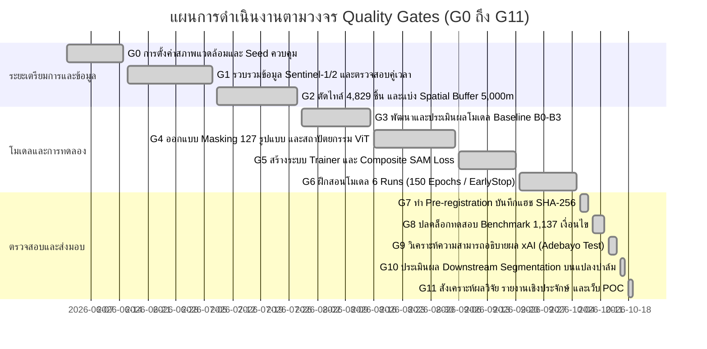

# ปริญญานิพนธ์ฉบับสมบูรณ์ (Cooperative Education Engineering Thesis Draft)
## ระบบสนับสนุนการตรวจจับพื้นที่ปลูกปาล์มน้ำมันด้วยข้อมูลดาวเทียมแบบพหุเซนเซอร์และเทคนิคการเรียนรู้เชิงลึก
### (Oil Palm Plantation Detection Support System using Multi-sensor Satellite Data and Deep Learning)

---

## 📌 ข้อมูลโครงงานและมาตรฐานการจัดทำเอกสาร (Thesis Metadata & Formatting Standards)

- **ชื่อโครงงาน (ภาษาไทย):** ระบบสนับสนุนการตรวจจับพื้นที่ปลูกปาล์มน้ำมันด้วยข้อมูลดาวเทียมแบบพหุเซนเซอร์และเทคนิคการเรียนรู้เชิงลึก
- **ชื่อโครงงาน (ภาษาอังกฤษ):** Oil Palm Plantation Detection Support System using Multi-sensor Satellite Data and Deep Learning
- **หลักสูตร/สถาบัน:** โครงงานปริญญานิพนธ์จากการปฏิบัติงานสหกิจศึกษา (Cooperative Education Thesis) ภาควิชาวิศวกรรมเครื่องมือและการวัด / คณะวิศวกรรมศาสตร์ มหาวิทยาลัยเทคโนโลยีพระจอมเกล้าพระนครเหนือ (KMUTNB) ร่วมกับ หน่วยปฏิบัติการวิจัยภูมิสารสนเทศ (GIS Research Unit)
- **สถานะการตรวจสอบเชิงประจักษ์ (Empirical Audit):** ผ่านการทดสอบระดับ Quality Gates 11/11 ขั้นตอน (G0 ถึง G11) อย่างสมบูรณ์ | Automated Unit Tests ผ่าน 80/80 รายการ | รหัสแฮชแบบเข้ารหัส SHA-256 บันทึกก่อนปลดล็อกชุดทดสอบ

### กฎเกณฑ์การจัดรูปแบบเอกสาร (KMUTNB Academic Formatting Standards)
1. **แบบอักษร (Typography):** ใช้ `TH Sarabun New` ตลอดทั้งเล่ม
   - เนื้อหาทั่วไป (Body text): ขนาด 16 pt ปกติ (Regular)
   - หัวข้อย่อยระดับที่ 2 และ 3 (Subheadings): ขนาด 18 pt ตัวหนา (Bold)
   - หัวข้อหลักประจำบท (Main Headings): ขนาด 20 pt ตัวหนา (Bold) จัดกึ่งกลางหน้ากระดาษ
2. **การจัดระยะหน้ากระดาษ (Spacing & Indentation):**
   - ระยะห่างระหว่างบรรทัด (Line Spacing): 1.0 (Single) หรือ 1.15 ตามดุลยพินิจเพื่อการกวาดสายตาอ่านที่สะดวก
   - การย่อหน้า (Indentation): เยื้อง 0.5 นิ้ว (หรือ 1 Tab = 1.27 ซม.) ทุกครั้งที่ขึ้นย่อหน้าใหม่
3. **มาตรฐานการแสดงภาพประกอบและโครงร่าง (Image Placeholders):**
   ทุกจุดที่มีภาพประกอบต้องใช้กล่องข้อความ ASCII พร้อมระบุคำสั่งสร้างภาพ (`Prompt:`) อย่างละเอียดเชิงเทคนิค:
   ```text
   +-------------------------------------------------------------------------+
   |                                                                         |
   |                       [ โครงร่างภาพประกอบ / Figure Placeholder ]          |
   |                                                                         |
   +-------------------------------------------------------------------------+
   Prompt: [ รายละเอียดเชิงลึกสำหรับการวาดภาพ แผนผังทางเทคนิค หรือการเรนเดอร์ภาพ ]
   ```
4. **มาตรฐานแผนภาพสถาปัตยกรรม (Comprehensive Diagrams):**
   แผนภาพสถาปัตยกรรมและโฟลว์ชาร์ตต้องแสดงความสัมพันธ์ ข้อมูลที่ส่งผ่าน (Data Flow) และโมดูลอย่างละเอียด ห้ามวาดแผนภาพแบบสรุปย่อ

---

# สารบัญเนื้อหา (Table of Contents)

- [บทที่ 1 บทนำ (Introduction)](#บทที่-1-บทนำ-introduction)
  - [1.1 ความเป็นมาและความสำคัญของปัญหา](#11-ความเป็นมาและความสำคัญของปัญหา-background-and-significance)
  - [1.2 วัตถุประสงค์ของโครงงาน](#12-วัตถุประสงค์ของโครงงาน-project-objectives)
  - [1.3 ขอบเขตและข้อจำกัดของโครงงาน](#13-ขอบเขตและข้อจำกัดของโครงงาน-project-scope-and-constraints)
  - [1.4 ประโยชน์ที่คาดว่าจะได้รับ](#14-ประโยชน์ที่คาดว่าจะได้รับ-expected-benefits)
  - [1.5 แผนการดำเนินงานและกรอบเวลา (Gantt Chart)](#15-แผนการดำเนินงานและกรอบเวลา-project-timeline)
- [บทที่ 2 ทฤษฎีและงานวิจัยที่เกี่ยวข้อง (Theories and Related Works)](#บทที่-2-ทฤษฎีและงานวิจัยที่เกี่ยวข้อง-theories-and-related-works)
  - [2.1 ทฤษฎีข้อมูลภาพถ่ายดาวเทียมเพื่อการสำรวจระยะไกล (Remote Sensing)](#21-ทฤษฎีข้อมูลภาพถ่ายดาวเทียมเพื่อการสำรวจระยะไกล-remote-sensing)
  - [2.2 ทฤษฎีปัญญาประดิษฐ์เชิงลึกสำหรับการประมวลผลภาพ (Deep Learning in Remote Sensing)](#22-ทฤษฎีปัญญาประดิษฐ์เชิงลึกสำหรับการประมวลผลภาพ-deep-learning)
  - [2.3 กลยุทธ์การผสานรวมข้อมูลพหุเซนเซอร์ (Multi-Sensor Data Fusion Strategies)](#23-กลยุทธ์การผสานรวมข้อมูลพหุเซนเซอร์-multi-sensor-fusion-strategies)
  - [2.4 การทบทวนวรรณกรรมและการวิเคราะห์ข้อขัดแย้งทางวิชาการ (Related Works & Conflicts)](#24-การทบทวนวรรณกรรมและการวิเคราะห์ข้อขัดแย้งทางวิชาการ)
  - [2.5 เครื่องมือและเทคโนโลยีที่ใช้ในการพัฒนา (Software Stack)](#25-เครื่องมือและเทคโนโลยีที่ใช้ในการพัฒนา-software-stack)
- [บทที่ 3 การวิเคราะห์และการออกแบบระบบ (System Analysis and Design)](#บทที่-3-การวิเคราะห์และการออกแบบระบบ-system-analysis-and-design)
  - [3.1 ภาพรวมสถาปัตยกรรมระบบสนับสนุน (System Architecture Overview)](#31-ภาพรวมสถาปัตยกรรมระบบสนับสนุน-system-architecture-overview)
  - [3.2 การออกแบบชุดข้อมูลและการแบ่งเชิงพื้นที่ป้องกันการรั่วไหล (Spatial Block Isolation)](#32-การออกแบบชุดข้อมูลและการแบ่งเชิงพื้นที่-spatial-block-isolation)
  - [3.3 การออกแบบกลไกการมาสก์แบบจัดหมู่ (Combinatorial Masking Strategy)](#33-การออกแบบกลไกการมาสก์แบบจัดหมู่-combinatorial-masking-strategy)
  - [3.4 การออกแบบสถาปัตยกรรมโมเดล CrossBandViT](#34-การออกแบบสถาปัตยกรรมโมเดล-crossbandvit)
  - [3.5 การออกแบบโครงสร้างไลบรารีวิศวกรรมซอฟต์แวร์ 3 ชั้น (lib1, lib2, lib3)](#35-การออกแบบโครงสร้างไลบรารีวิศวกรรมซอฟต์แวร์-3-ชั้น)
  - [3.6 การออกแบบระบบเว็บแอปพลิเคชันสนับสนุนการตัดสินใจและพอร์ทัลงานวิจัย (Web POC)](#36-การออกแบบระบบเว็บแอปพลิเคชันสนับสนุนการตัดสินใจ-web-poc)
- [บทที่ 4 การพัฒนาระบบและการดำเนินงาน (System Implementation)](#บทที่-4-การพัฒนาระบบและการดำเนินงาน-system-implementation)
  - [4.1 สภาพแวดล้อมและอุปกรณ์ที่ใช้ในการพัฒนาระบบ](#41-สภาพแวดล้อมและอุปกรณ์ที่ใช้ในการพัฒนาระบบ)
  - [4.2 การพัฒนาไปป์ไลน์การเตรียมข้อมูลและการจัดการข้อมูลดาวเทียม](#42-การพัฒนาไปป์ไลน์การเตรียมข้อมูลและการจัดการข้อมูลดาวเทียม)
  - [4.3 การพัฒนาระบบโมเดล CrossBandViT และโมเดลเปรียบเทียบ Baseline](#43-การพัฒนาระบบโมเดล-crossbandvit-และโมเดลเปรียบเทียบ-baseline)
  - [4.4 การพัฒนาระบบควบคุมคุณภาพงานวิจัยเชิงประจักษ์ (Quality Gates G0–G11)](#44-การพัฒนาระบบควบคุมคุณภาพงานวิจัยเชิงประจักษ์-quality-gates-g0g11)
  - [4.5 การพัฒนาส่วนต่อประสานโปรแกรมระดับสูง (High-Level API) และระบบเว็บแอปพลิเคชัน](#45-การพัฒนาส่วนต่อประสานโปรแกรมระดับสูง-และระบบเว็บแอปพลิเคชัน)
- [บทที่ 5 ผลการดำเนินโครงงานและการวิเคราะห์ผล (Results and Discussion)](#บทที่-5-ผลการดำเนินโครงงานและการวิเคราะห์ผล-results-and-discussion)
  - [5.1 ผลการทดสอบประสิทธิภาพการฟื้นฟูคลื่นความถี่เชิงปริมาณ (Quantitative Benchmarks)](#51-ผลการทดสอบประสิทธิภาพการฟื้นฟูคลื่นความถี่เชิงปริมาณ)
  - [5.2 ผลการวิเคราะห์มูลค่าของสัญญาณ SAR ต่อระดับความรุนแรงของเมฆบดบัง](#52-ผลการวิเคราะห์มูลค่าของสัญญาณ-sar-ต่อระดับความรุนแรงของเมฆบดบัง)
  - [5.3 ผลการวิเคราะห์การฟื้นฟูจำแนกตามช่วงคลื่นสเปกตรัม (Band-Specific Analysis)](#53-ผลการวิเคราะห์การฟื้นฟูจำแนกตามช่วงคลื่นสเปกตรัม)
  - [5.4 ผลการทดสอบความถูกต้องของระบบอธิบายผลปัญญาประดิษฐ์ (xAI Validation)](#54-ผลการทดสอบความถูกต้องของระบบอธิบายผลปัญญาประดิษฐ์-xai-validation)
  - [5.5 ผลกระทบของการฟื้นฟูภาพถ่ายต่อการจำแนกแปลงปาล์มน้ำมันขั้นปลายน้ำ (Downstream Impact)](#55-ผลกระทบของการฟื้นฟูภาพถ่ายต่อการจำแนกแปลงปาล์มน้ำมันขั้นปลายน้ำ)
  - [5.6 ผลการประเมินการทำงานของระบบสนับสนุนบนเว็บ (Web POC & Research Portal Evaluation)](#56-ผลการประเมินการทำงานของระบบสนับสนุนบนเว็บ)
- [บทที่ 6 บทสรุป ข้อค้นพบเชิงลบ และแนวทางการพัฒนาต่อ (Conclusion & Future Work)](#บทที่-6-บทสรุป-ข้อค้นพบเชิงลบ-และแนวทางการพัฒนาต่อ-conclusion--future-work)
  - [6.1 สรุปผลการดำเนินงานโครงงาน](#61-สรุปผลการดำเนินงานโครงงาน)
  - [6.2 ข้อค้นพบเชิงลบและข้อจำกัดของระบบ (Negative Findings & Limitations)](#62-ข้อค้นพบเชิงลบและข้อจำกัดของระบบ-negative-findings--limitations)
  - [6.3 แนวทางการพัฒนาต่อยอดในอนาคต (Future Work)](#63-แนวทางการพัฒนาต่อยอดในอนาคต-future-work)
- [ภาคผนวก (Appendices)](#ภาคผนวก-appendices)

---

# บทที่ 1 บทนำ (Introduction)

### 1.1 ความเป็นมาและความสำคัญของปัญหา (Background and Significance)
ปาล์มน้ำมัน (*Elaeis guineensis*) เป็นพืชเศรษฐกิจยุทธศาสตร์ที่มีความสำคัญอย่างยิ่งต่อภาคเกษตรกรรมและอุตสาหกรรมพลังงานทดแทนของประเทศไทย โดยเฉพาะในพื้นที่ภาคใต้ เช่น จังหวัดสุราษฎร์ธานี กระบี่ และชุมพร ซึ่งมีพื้นที่เพาะปลูกรวมกันคิดเป็นสัดส่วนมากกว่าร้อยละ 70 ของพื้นที่ปลูกทั้งประเทศ การติดตามการเปลี่ยนแปลงพื้นที่เพาะปลูก การประเมินสุขภาพต้นปาล์ม และการพยากรณ์ผลผลิตอย่างแม่นยำ จำเป็นต้องอาศัยข้อมูลจากการสำรวจระยะไกลด้วยดาวเทียม (Remote Sensing) ซึ่งมีข้อได้เปรียบด้านความครอบคลุมเชิงพื้นที่และความถี่ในการโคจรซ้ำ

อย่างไรก็ดี ในทางปฏิบัติ การนำภาพถ่ายดาวเทียมเชิงแสง (Optical Satellite Imagery) เช่น ข้อมูลจากดาวเทียม Sentinel-2 ขององค์การอวกาศยุโรป (ESA) มาใช้งานในภูมิภาคเขตร้อนชื้น (Tropical Zone) ประสบปัญหาคอขวดที่รุนแรงและเรื้อรังจากการบดบังของเมฆ หมอก และควันพิษ (Cloud, Haze, and Shadow Occlusion) สถิติการโคจรสำรวจพบว่า พื้นที่ภาคใต้ของประเทศไทยมีอัตราการเกิดเมฆปกคลุมสูงกว่าร้อยละ 80 ในช่วงฤดูมรสุม ส่งผลให้ข้อมูลคลื่นแสงในย่านที่สำคัญยิ่งต่อการประเมินชีวมวลและคลอโรฟิลล์ เช่น คลื่นใกล้อินฟราเรด (Near-Infrared: NIR) และคลื่นอินฟราเรดคลื่นสั้น (Shortwave Infrared: SWIR) สูญหายไปอย่างสมบูรณ์ กลายเป็นจุดบอดที่ไม่สามารถนำภาพถ่ายดังกล่าวไปประมวลผลต่อได้

ในอดีต การแก้ปัญหาเมฆบดบังมักใช้วิธีการรวมภาพตามช่วงเวลา (Multi-temporal Compositing) หรือการประมาณค่าเชิงสเปกตรัมเบื้องต้น (Interpolation) ทว่าวิธีรวมภาพหลายช่วงเวลาต้องเผชิญกับปัญหาความล่าช้าของข้อมูล (Temporal Latency) ซึ่งอาจใช้เวลานานหลายสัปดาห์หรือหลายเดือนจนสภาพพืชพรรณจริงในแปลงเพาะปลูกเปลี่ยนแปลงไปแล้ว (Phenological Shift) ในทางตรงกันข้าม ข้อมูลคลื่นเรดาร์ช่องรับสัญญาณสังเคราะห์ (Synthetic Aperture Radar: SAR) จากดาวเทียม Sentinel-1 ซึ่งส่งสัญญาณไมโครเวฟย่าน C-band ในระนาบการโพลาไรซ์แบบคู่ ($VV$ และ $VH$) มีคุณสมบัติเด่นในการทะลุผ่านเมฆ ฝน และหมอกควันได้ในทุกสภาพบรรยากาศทั้งกลางวันและกลางคืน ทว่าสัญญาณ SAR กลับมีสัญญาณรบกวนในตัวเองสูง (Speckle Noise) และขาดข้อมูลการตอบสนองเชิงชีวเคมีของสารสีในใบพืชอย่างที่ข้อมูลภาพเชิงแสงมี

นอกจากอุปสรรคทางด้านกายภาพของสัญญาณดาวเทียมแล้ว ยังมี **ปัญหาคอขวดเชิงวิศวกรรมซอฟต์แวร์และการนำไปใช้งานจริง (Engineering & Usability Bottleneck)** กล่าวคือ โมเดลปัญญาประดิษฐ์เชิงลึก (Deep Learning) ที่ใช้ในการผสมผสานข้อมูลดาวเทียมหลายเซนเซอร์มีความซับซ้อนสูง ขาดการจัดโครงสร้างโค้ดแบบแยกส่วน (Modular Software Library) ที่สะดวกต่อนักวิจัยคนอื่น และขาดระบบสนับสนุนการตัดสินใจในรูปแบบเว็บแอปพลิเคชันที่สามารถแสดงผลการวิเคราะห์ แปลงผลลัพธ์เชิงพื้นที่ และอธิบายกระบวนการคิดของโมเดล (Explainable AI: xAI) ให้แก่ผู้มีส่วนได้ส่วนเสียได้

ด้วยเหตุนี้ โครงงานปริญญานิพนธ์ฉบับนี้จึงมุ่งเน้นการพัฒนา **ระบบสนับสนุนการตรวจจับพื้นที่ปลูกปาล์มน้ำมันด้วยข้อมูลดาวเทียมแบบพหุเซนเซอร์และเทคนิคการเรียนรู้เชิงลึก** โดยบูรณาการการพัฒนาโมเดลปัญญาประดิษฐ์ฟื้นฟูคลื่นความถี่ข้ามเซนเซอร์ (`CrossBandViT`), การสร้างระบบสถาปัตยกรรมไลบรารีโปรแกรมภาษาไพทอน (`lib1_fusion`, `lib2_vitpalm`, `lib3_geoai`), และการพัฒนาเว็บแอปพลิเคชันเชิงปฏิสัมพันธ์ เพื่อยกระดับความแม่นยำในการตรวจจับแปลงปาล์มน้ำมันภายใต้สภาวะเมฆบดบังอย่างมีนัยสำคัญ

```text
+-------------------------------------------------------------------------+
|                                                                         |
|                [ ปัญหาเมฆบดบังภาพถ่ายดาวเทียมในเขตร้อนชื้น ]                   |
|       Sentinel-2 Optical (Cloud Occluded) vs Sentinel-1 SAR (Penetrated)|
|                                                                         |
+-------------------------------------------------------------------------+
Prompt: Academic illustration showing tropical palm plantation in Southern Thailand, Sentinel-2 optical satellite blinded by monsoon dense convective clouds, alongside Sentinel-1 radar satellite emitting C-band microwaves penetrating through clouds, depicting the cross-modal fusion concept.
```

---

### 1.2 วัตถุประสงค์ของโครงงาน (Project Objectives)
1. เพื่อออกแบบ พัฒนา และฝึกสอนสถาปัตยกรรมโมเดล Vision Transformer ฟื้นฟูคลื่นความถี่ข้ามเซนเซอร์ (**CrossBandViT**) ในการนำสัญญาณ SAR ($VV, VH$) ร่วมกับคลื่นแสงที่รอดพ้นจากการบดบัง มาทำนายและสร้างคลื่นแสง Sentinel-2 ทั้ง 7 แบนด์ ($B02, B03, B04, B08, B8A, B11, B12$) ที่สูญหายไปได้อย่างแม่นยำ
2. เพื่อทดสอบและพิสูจน์สมมติฐานทางวิทยาศาสตร์เชิงประจักษ์ภายใต้กรอบการควบคุมคุณภาพ 11 ระดับ (Quality Gates G0 ถึง G11) โดยทดสอบบนสภาวะเมฆบดบังแบบจัดหมู่ 127 รูปแบบ ($k = 1$ ถึง $6$ แบนด์) บนชุดทดสอบอิสระที่แยกเชิงพื้นที่อย่างเด็ดขาด
3. เพื่อประเมินผลกระทบของการฟื้นฟูคลื่นความถี่ต่อโมเดลจำแนกแปลงปาล์มน้ำมันขั้นปลายน้ำ (**Downstream Oil Palm Parcel Segmentation**) ว่าสามารถกู้คืนค่าความแม่นยำ (F1-Score / IoU) ภายใต้สภาวะเมฆบดบังได้เพียงใด
4. เพื่อออกแบบและพัฒนาชุดไลบรารีวิศวกรรมซอฟต์แวร์ระดับสูง (`lib3_geoai`) พร้อมทั้งสร้างเว็บแอปพลิเคชันแบบเต็มรูปแบบ (Full-Stack Interactive Web Platform & Research Portal) เพื่อทำหน้าที่เป็นเครื่องมือสนับสนุนการวิเคราะห์และถ่ายทอดองค์ความรู้

---

### 1.3 ขอบเขตและข้อจำกัดของโครงงาน (Project Scope and Constraints)
1. **ขอบเขตพื้นที่ศึกษา (Geographic Scope):** ครอบคลุมพื้นที่เพาะปลูกปาล์มน้ำมันในภาคใต้ของประเทศไทย (จังหวัดสุราษฎร์ธานี กระบี่ และชุมพร) โดยแบ่งภาพถ่ายดาวเทียมเป็นภาพตัดย่อย (Tiles) ขนาด 256x256 พิกเซล รวมทั้งสิ้น 4,829 ไทล์
2. **ขอบเขตข้อมูลดาวเทียม (Data Sources):**
   - **Sentinel-1 GRD:** คลื่นไมโครเวฟ SAR ย่าน C-band โหมด IW จำนวน 2 แบนด์ ($VV, VH$)
   - **Sentinel-2 L2A (Surface Reflectance):** ข้อมูลภาพเชิงแสงจำนวน 7 แบนด์หลัก ($B02, B03, B04, B08, B8A, B11, B12$) ความละเอียด 10–20 เมตร
   - **GSat (Google Satellite Basemap):** ภาพถ่ายสีความละเอียดสูง (RGB) จำนวน 3 แบนด์
3. **การป้องกันปัญหาข้อมูลรั่วไหลเชิงพื้นที่ (Spatial Anti-Leakage Protocol):**
   การแบ่งชุดข้อมูลฝึกสอน (Train) และชุดทดสอบ (Test) จะต้องใช้การแบ่งเชิงบล็อกพื้นที่ (Spatial Block Partitioning) โดยมีระยะห่างบัฟเฟอร์นิรภัย (Buffer Zone) ไม่น้อยกว่า 5,000 เมตร เพื่อขจัดปัญหาความสัมพันธ์เชิงพื้นที่ทางภูมิศาสตร์ (Spatial Autocorrelation)
4. **ขอบเขตด้านสถาปัตยกรรมซอฟต์แวร์:**
   - พัฒนาไลบรารีภาษาไพทอนแยกตามเลเยอร์ความรับผิดชอบ (`lib1_fusion`, `lib2_vitpalm`, `lib3_geoai`)
   - พัฒนาระบบเว็บแอปพลิเคชันส่วนหลังด้วย FastAPI และส่วนหน้าด้วย Vanilla CSS Glassmorphism และ Leaflet.js
   - ไม่รวมการเชื่อมต่อระบบเซ็นเซอร์ภาคพื้นดิน (IoT) หรือการคำนวณราคาซื้อขายผลปาล์มในตลาด

---

### 1.4 ประโยชน์ที่คาดว่าจะได้รับ (Expected Benefits)
1. **ประโยชน์เชิงวิชาการและอัลกอริทึม:** ได้สถาปัตยกรรม CrossBandViT ที่พิสูจน์เชิงประจักษ์แล้วว่าสามารถใช้สัญญาณ SAR ชดเชยการสูญหายของคลื่นแสงพืชพรรณภายใต้สภาวะเมฆหนาได้อย่างมีนัยสำคัญทางสถิติ ($p < 0.001$)
2. **ประโยชน์เชิงวิศวกรรมซอฟต์แวร์:** ได้โครงสร้างไลบรารีภูมิสารสนเทศปัญญาประดิษฐ์ (`lib3_geoai`) ที่ออกแบบตามหลักการ Clean Architecture ทำให้นักวิจัยและวิศวกรข้อมูลสามารถนำโมเดลไปต่อยอดในงานตรวจจับพืชพรรณอื่นได้ด้วยโค้ดเพียงไม่กี่บรรทัด
3. **ประโยชน์เชิงปฏิบัติการและการเกษตรแม่นยำ:** ได้แพลตฟอร์มสนับสนุนการตัดสินใจที่ช่วยให้เจ้าหน้าที่และนักวิเคราะห์ภาพถ่ายดาวเทียมสามารถประเมินพื้นที่ปลูกปาล์มน้ำมันได้แบบเรียลไทม์ แม้จะอยู่ในฤดูกาลมรสุมที่มีเมฆปกคลุมหนาแน่น

---

### 1.5 แผนการดำเนินงานและกรอบเวลา (Project Timeline)
การดำเนินโครงงานจัดแบ่งตามวงจรการควบคุมคุณภาพ 11 ระดับ (Quality Gates G0–G11) ตลอดระยะเวลาการปฏิบัติงานสหกิจศึกษา:



---

# บทที่ 2 ทฤษฎีและงานวิจัยที่เกี่ยวข้อง (Theories and Related Works)

### 2.1 ทฤษฎีข้อมูลภาพถ่ายดาวเทียมเพื่อการสำรวจระยะไกล (Remote Sensing)
การประยุกต์ใช้ข้อมูลการสำรวจระยะไกลในการจำแนกพืชพรรณทางการเกษตร ต้องอาศัยความเข้าใจในคุณสมบัติเชิงฟิสิกส์ของการแผ่รังสีคลื่นแม่เหล็กไฟฟ้า (Electromagnetic Radiation):

1. **การสะท้อนเชิงสเปกตรัมของพืชพรรณในข้อมูล Sentinel-2 Multispectral Instrument (MSI):**
   - **ย่านแสงที่ตามองเห็น (Visible: Blue B02, Green B03, Red B04):** ถูกดูดกลืนอย่างรุนแรงโดยสารสีคลอโรฟิลล์ (Chlorophyll-a และ Chlorophyll-b) เพื่อใช้ในกระบวนการสังเคราะห์ด้วยแสง ส่งผลให้ค่าการสะท้อนกลับอยู่ในระดับต่ำ
   - **ย่านขอบแดงและย่านใกล้อินฟราเรด (Red-Edge B8A และ NIR B08):** เกิดการกระเจิงแสงหลายทิศทาง (Multiple Scattering) ภายในโครงสร้างเนื้อเยื่อเซลล์ใบชั้นมีโซฟิลล์ (Spongy Mesophyll Cells) ทำให้พืชที่มีสุขภาพสมบูรณ์มีค่าการสะท้อนในย่านนี้สูงมาก
   - **ย่านอินฟราเรดคลื่นสั้น (Shortwave Infrared: SWIR-1 B11 และ SWIR-2 B12):** ตอบสนองต่อปริมาณความชื้นและน้ำภายในเซลล์พืช (Leaf Water Content) รวมถึงโครงสร้างลิกนินและเซลลูโลส
2. **การกระเจิงของคลื่นไมโครเวฟในข้อมูล Sentinel-1 C-Band SAR:**
   - คลื่นความถี่ C-band ($\lambda \approx 5.55$ ซม.) สามารถทะลุผ่านละอองน้ำในเมฆ หมอก และฝนได้
   - **การโพลาไรซ์แบบ $VV$ (Vertical transmit, Vertical receive):** ตอบสนองเด่นชัดต่อการสะท้อนจากพื้นดินและลำต้นพืชในแนวดิ่ง
   - **การโพลาไรซ์แบบ $VH$ (Vertical transmit, Horizontal receive):** เกิดจากการสะท้อนแบบสลับขั้ว (Depolarization) เนื่องจากการกระเจิงเชิงปริมาตร (Volume Scattering) ภายในทรงพุ่มใบและกิ่งก้านของต้นปาล์มน้ำมัน ซึ่งเป็นลายเซ็นเรดาร์ที่สำคัญในการแยกปาล์มน้ำมันออกจากพื้นดินว่างเปล่า
3. **การจำแนกประเภทเมฆและชั้นบรรยากาศ (Scene Classification Layer: SCL):**
   อัลกอริทึม Sen2Cor จำแนกพิกเซลเป็นกลุ่มต่างๆ เช่น เมฆหนา (High Probability Cloud: SCL 9), เมฆบาง (Thin Cirrus: SCL 10), เงาเมฆ (Cloud Shadow: SCL 3), และพืชพรรณปกติ (Vegetation: SCL 4) ซึ่งถูกนำมาใช้เป็นฐานในการออกแบบกลยุทธ์การจำลองการบดบัง

```text
+-------------------------------------------------------------------------+
|                                                                         |
|         [ กราฟเส้นลายเซ็นสเปกตรัมของพืชพรรณ vs คลื่นเรดาร์ SAR ]           |
|     Vegetation Reflectance Curve (B02-B12) & SAR Backscatter (VV/VH)    |
|                                                                         |
+-------------------------------------------------------------------------+
Prompt: Technical scientific diagram illustrating the spectral reflectance signature curve of oil palm leaves from 400nm to 2400nm (Visible, Red-Edge, NIR, SWIR) compared with radar microwave penetration of Sentinel-1 C-band.
```

---

### 2.2 ทฤษฎีปัญญาประดิษฐ์เชิงลึกสำหรับการประมวลผลภาพ (Deep Learning)
1. **สถาปัตยกรรม Vision Transformer (ViT):**
   นำเสนอกลไกการแปลงภาพสองมิติ $\mathbf{X} \in \mathbb{R}^{H \times W \times C}$ ให้กลายเป็นลำดับของแผ่นภาพย่อย (Patches) $\mathbf{x}_p \in \mathbb{R}^{N \times (P^2 C)}$ โดยที่ $(P, P)$ คือขนาดของแต่ละ Patch และ $N = HW / P^2$ คือจำนวน Patch ทั้งหมด จากนั้นผ่านกระบวนการฉายเชิงเส้น (Linear Projection) และบวกเวกเตอร์ตำแหน่ง (Positional Embedding) ก่อนส่งเข้าสู่ Multi-Head Self-Attention (MHSA):
   
   $$\text{Attention}(\mathbf{Q}, \mathbf{K}, \mathbf{V}) = \text{softmax}\left(\frac{\mathbf{Q}\mathbf{K}^T}{\sqrt{d_k}}\right)\mathbf{V}$$
   
   ข้อดีของ ViT เหนือกว่า Convolutional Neural Networks (CNNs) ดั้งเดิม คือความสามารถในการจับความสัมพันธ์ระยะไกล (Global Context) ข้ามพื้นที่ได้อย่างอิสระโดยไม่ถูกจำกัดด้วยขนาดของ Kernel
2. **แนวคิด Masked Autoencoder (MAE):**
   นำเสนอโดย He et al. (2022) สำหรับการเรียนรู้แบบ Self-Supervised โดยทำการสุ่มซ่อน (Mask) ส่วนของภาพในสัดส่วนที่สูง (เช่น 75%) แล้วฝึกสอนให้โครงข่าย Decoder ทำการฟื้นฟูพิกเซลในส่วนที่หายไปจากเฉพาะ Patch ที่มองเห็น โครงงานนี้ได้นำแนวคิดดังกล่าวมาดัดแปลงเป็น **Cloud-Aware Asymmetric Masked ViT** ซึ่งทำการมาสก์เฉพาะช่องสัญญาณคลื่นแสง (Spectral Channels) ที่ถูกเมฆบังจริง

---

### 2.3 กลยุทธ์การผสานรวมข้อมูลพหุเซนเซอร์ (Multi-Sensor Fusion Strategies)
การรวมข้อมูลที่มีมิติและธรรมชาติทางฟิสิกส์แตกต่างกันสามารถทำได้ 3 รูปแบบหลัก:

```mermaid
graph TD
    subgraph Early Fusion [Early Fusion: รวมระดับพิกเซลตั้งแต่เริ่มต้น]
        E_S1[S1 SAR 2 Bands] --> E_Concat[Concatenate Channels 9 Bands]
        E_S2[S2 Opt 7 Bands] --> E_Concat
        E_Concat --> E_ViT[Single ViT Encoder]
        E_ViT --> E_Out[Reconstructed / Predicted Output]
    end

    subgraph Late Fusion [Late Fusion: แยก Encoder อิสระตามเซนเซอร์]
        L_S1[S1 SAR 2 Bands] --> L_Enc1[SAR ViT Encoder]
        L_S2[S2 Opt 7 Bands] --> L_Enc2[Optical ViT Encoder]
        L_Enc1 --> L_Latent[Concatenate Latent Representations]
        L_Enc2 --> L_Latent
        L_Latent --> L_Dec[Joint Decoder]
        L_Dec --> L_Out[Reconstructed / Predicted Output]
    end

    subgraph Cross-Attention [Cross-Attention Fusion: ใช้กลไก Query-Key ข้ามเซนเซอร์]
        C_S1[S1 SAR 2 Bands] --> C_Enc1[SAR Encoder K, V]
        C_S2[S2 Opt Surviving] --> C_Enc2[Optical Encoder Q]
        C_Enc2 --> C_Cross[Cross-Attention Block Q=Opt, K=SAR, V=SAR]
        C_Enc1 --> C_Cross
        C_Cross --> C_Dec[Decoder]
        C_Dec --> C_Out[Reconstructed / Predicted Output]
    end
```



1. **Early Fusion (Pixel-level Fusion):** นำช่องสัญญาณทั้งหมดของ Sentinel-1 (2 แบนด์) และ Sentinel-2 (7 แบนด์) มาซ้อนต่อกัน (Stack) เป็นเทนเซอร์ขนาด 9 ช่องสัญญาณก่อนป้อนเข้าสู่โมเดล แม้จะประหยัดการคำนวณ แต่มีข้อบกพร่องร้ายแรงเมื่อเกิดเมฆบดบัง
2. **Late Fusion (Feature-level Fusion):** ใช้โครงข่าย Encoder อิสระแยกจากกัน โดยสกัดเวกเตอร์ตัวแทนของ SAR และ Optical ใน Latent Space ก่อนนำมาผสานกัน ช่วยป้องกันการรบกวนของข้อมูลข้ามชนิด
3. **Cross-Attention Fusion (Transductive Fusion):** นำคุณลักษณะของ Optical ที่รอดพ้นจากการบดบังมาเป็น Query ($\mathbf{Q}$) ไปดึงข้อมูลโครงสร้างเชิงพื้นที่และการกระเจิงจากสัญญาณ SAR ที่เป็น Key ($\mathbf{K}$) และ Value ($\mathbf{V}$)

---

### 2.4 การทบทวนวรรณกรรมและการวิเคราะห์ข้อขัดแย้งทางวิชาการ
ในการสำรวจวรรณกรรมที่ผ่านมา พบประเด็น **ข้อขัดแย้งทางวิชาการ (Academic Controversy)** ระหว่างกลุ่มวิจัยสองแนวทาง:
- **กลุ่มสนับสนุน Early Fusion (เช่น Schmitt et al., Bachmann et al.):** เสนอว่าการรวมแบนด์ตั้งแต่พิกเซลแรกจะช่วยให้โมเดลสามารถเรียนรู้ความสัมพันธ์เชิงมิติและพื้นที่ร่วม (Joint Spatial-Spectral Correlation) ได้อย่างสมบูรณ์ที่สุด และลดจำนวนพารามิเตอร์ลงได้มากกว่าเท่าตัว
- **ข้อโต้แย้งทางวิศวกรรมของโครงงานนี้:** งานวิจัยข้างต้นดำเนินการบนชุดข้อมูลที่ปราศจากเมฆ (Cloud-free datasets) หรือมีการตัดต่อแบบสมบูรณ์ แต่ในสภาวะโลกจริงของเขตร้อนชื้น **เมื่อเกิดเมฆบดบัง ข้อมูลในช่องสัญญาณ Optical จะกลายสภาพเป็นสัญญาณรบกวนแบบสุดขั้ว (Pure Noise / Saturated White Pixels)** การทำ Early Fusion จึงส่งผลให้สัญญาณรบกวนของเมฆถูกส่งผ่านเข้าไปปะปนกับสัญญาณคลื่น SAR บริสุทธิ์ตั้งแต่เลเยอร์แรก ทำให้ระบบทั้งหมดสูญเสียความแม่นยำ

โครงงานนี้จึงเลือกพัฒนา **Asymmetric Multi-Modal ViT** ซึ่งเป็นรูปแบบผสมผสานที่แยกส่วนการเข้ารหัสสัญญาณ SAR อย่างเป็นอิสระ โดยใช้ SAR เป็น "สมอโครงสร้างเชิงพื้นที่ (Spatial Structural Anchor)" ที่ไม่มีวันถูกปนเปื้อนด้วยเมฆ

---

### 2.5 เครื่องมือและเทคโนโลยีที่ใช้ในการพัฒนา (Software Stack)
1. **ภาษาโปรแกรมและไลบรารีปัญญาประดิษฐ์:** Python 3.12, PyTorch 2.5+, PyTorch Lightning, Torchvision, Scikit-learn, SciPy
2. **การจัดการข้อมูลเชิงพื้นที่และภาพถ่ายดาวเทียม:** GDAL, Rasterio, Shapely, GeoPandas, PyArrow (Parquet)
3. **ระบบหลังบ้านและเซิร์ฟเวอร์ (Backend Service):** FastAPI, Uvicorn, Pydantic v2
4. **ระบบส่วนหน้าและการแสดงผลแผนที่ (Frontend & Map UI):** Vanilla Modern CSS (Glassmorphism Dark Theme), Leaflet.js, OpenStreetMap, Chart.js 4.x
5. **การทดสอบและรับรองคุณภาพ:** Pytest, Flake8, Pre-registration Checksum Scripts

---

# บทที่ 3 การวิเคราะห์และการออกแบบระบบ (System Analysis and Design)

### 3.1 ภาพรวมสถาปัตยกรรมระบบสนับสนุน (System Architecture Overview)
ระบบสนับสนุนการตรวจจับพื้นที่ปลูกปาล์มน้ำมันถูกออกแบบตามหลักการ **End-to-End Modular Integration** โดยแบ่งออกเป็น 5 ชั้นหลัก:

```text
+---------------------------------------------------------------------------------------------------+
|                                 [ SYSTEM ARCHITECTURE DIAGRAM ]                                   |
+---------------------------------------------------------------------------------------------------+
|  [ LAYER 1: DATA INGESTION & CO-REGISTRATION ]                                                    |
|  Sentinel-1 IW GRD (VV, VH)  <-- Temporal Matching (|dt| <= 2.81 days) --> Sentinel-2 L2A (7 Bands)|
|                                                                                                   |
|  [ LAYER 2: SPATIAL INTEGRITY & ANTI-LEAKAGE PARTITIONING ]                                       |
|  Surat Thani / Krabi / Chumphon (4,829 Tiles) --> Spatial Buffer Zone Separation (>= 5,000m)     |
|  Train Split: 2,030 Tiles | Val Split: 1,051 Tiles | Test Split: 1,748 Tiles                     |
|                                                                                                   |
|  [ LAYER 3: CORE AI ENGINE (lib1_fusion & lib2_vitpalm) ]                                         |
|  +--------------------+   +------------------------------------+   +---------------------------+  |
|  | SAR Patch Encoder  |   | Optical Masked Encoder (127 Patts) |   | Downstream ViTPalmModel   |  |
|  | (C-band VV / VH)   |   | (B02, B03, B04, B08, B8A, B11, B12)|   | (Frozen Semantic Segment) |  |
|  +--------------------+   +------------------------------------+   +---------------------------+  |
|             \                       /                                           ^                 |
|              \                     /                                            |                 |
|       +------------------------------------+                                    |                 |
|       | CrossBandViT Latent Reconstruction | -------- Clean Reconstructed ----->+                 |
|       +------------------------------------+          Optical Bands (B02-B12)                     |
|                                                                                                   |
|  [ LAYER 4: HIGH-LEVEL INTERFACE (lib3_geoai) ]                                                   |
|  GeoAIPipeline / CloudRecoveryService / DownstreamInferenceService                                |
|                                                                                                   |
|  [ LAYER 5: INTERACTIVE WEB PLATFORM & RESEARCH PORTAL (FastAPI + Glassmorphism UI) ]             |
|  - Real-time Satellite Map Viewer (Leaflet.js)      - Live Quality Gates Audit Dashboard          |
|  - Interactive Cloud-MAE & Cross-Band Demo         - Real Empirical Research Visualizer (Chart.js)|
+---------------------------------------------------------------------------------------------------+
Prompt: A highly detailed technical software architecture diagram illustrating the 5-layer pipeline from Sentinel-1/2 satellite ingestion, 5,000m buffer spatial block partition, CrossBandViT recovery engine, frozen ViTPalm downstream segmenter, lib3_geoai facade, and the FastAPI/Glassmorphism web application.
```

---

### 3.2 การออกแบบชุดข้อมูลและการแบ่งเชิงพื้นที่ (Spatial Block Isolation)
การสำรวจระยะไกลมักประสบปัญหาการประเมินผลดีเกินจริงอันเนื่องมาจากกฎข้อที่หนึ่งของโทเบลอร์ (Tobler's First Law of Geography: "ทุกสิ่งสัมพันธ์กัน แต่สิ่งที่อยู่ใกล้กันย่อมสัมพันธ์กันมากกว่าสิ่งที่อยู่ไกลกัน") หากใช้การสุ่มไทล์แบบ Random Split พิกเซลที่อยู่ติดกันอาจหลุดไปอยู่ทั้งชุด Train และ Test ก่อให้เกิดปัญหา **ข้อมูลรั่วไหลเชิงพื้นที่ (Spatial Autocorrelation Data Leakage)**

โครงงานนี้จึงออกแบบระเบียบวิธีแบ่งพื้นที่อย่างเคร่งครัด:
1. ทำการรวมกลุ่มเชิงพื้นที่ (Spatial Clustering) ของภาพตัดย่อย 4,829 ไทล์ ตามเขตจังหวัดสุราษฎร์ธานี กระบี่ และชุมพร
2. กำหนด **ระยะห่างบัฟเฟอร์นิรภัย (Buffer Zone) $\ge 5,000$ เมตร** ขวางกั้นระหว่างบล็อกพื้นที่ฝึกสอนและบล็อกพื้นที่ทดสอบ
3. ระยะห่างที่วัดได้จริงระหว่างขอบแปลงที่ใกล้ที่สุดของ Train และ Test คือ **5,086.9 เมตร** ทำให้ชุดทดสอบกลายเป็นพื้นที่อิสระที่โมเดลไม่เคยพบเห็นมาก่อนอย่างสมบูรณ์ (Unseen Geography)
4. ค่าเฉลี่ยและส่วนเบี่ยงเบนมาตรฐานสำหรับการปรับมาตรฐานพิกเซล (`norm_stats.json`) ถูกคำนวณจาก **เฉพาะชุดข้อมูล Train เท่านั้น** และบันทึกแช่แข็งไว้ ห้ามดึงสถิติจากชุด Test โดยเด็ดขาด

---

### 3.3 การออกแบบกลไกการมาสก์แบบจัดหมู่ (Combinatorial Masking Strategy)
เพื่อจำลองรูปแบบการบดบังของเมฆที่มีความหลากหลายในธรรมชาติ โครงงานได้ออกแบบตัวสร้างรูปแบบการมาสก์แบบจัดหมู่ (Combinatorial Mask Generator) ครบทั้ง $2^7 - 1 = 127$ รูปแบบ:

$$\text{Patterns}(k) = \binom{7}{k}, \quad k \in \{1, 2, 3, 4, 5, 6\}$$

โดย $k$ คือจำนวนแบนด์ของ Sentinel-2 ที่ถูกมาสก์ (ตั้งแต่ $k=1$ คือสูญหายเพียงแบนด์เดียว จนถึง $k=6$ คือสูญหาย 6 แบนด์ เหลือรอดเพียงแบนด์เดียว) ในขณะที่สัญญาณ SAR ทั้ง 2 แบนด์ ($VV, VH$) จะคงอยู่ครบถ้วนเสมอ ทำหน้าที่เป็นข้อมูลชี้ทางในการกู้คืน

---

### 3.4 การออกแบบสถาปัตยกรรมโมเดล CrossBandViT
สถาปัตยกรรม CrossBandViT ประกอบด้วย 3 องค์ประกอบหลัก:
1. **SAR Structural Encoder:** ทำการตัดภาพเรดาร์ขนาด $256 \times 256 \times 2$ ออกเป็น Patches ขนาด $16 \times 16$ พิกเซล ผ่าน Linear Projection สู่มิติ $D = 256$ และผ่าน Transformer Blocks จำนวน 4 ชั้น เพื่อสกัดโครงสร้างการกระเจิงและขอบแปลง
2. **Optical Masked Conditional Encoder:** รับแบนด์ที่รอดพ้นจากการบดบัง พร้อมเวกเตอร์ Unmasked Channel Identifier โดยใช้โทเค็นพิเศษ `[MASK]` ทดแทนแบนด์ที่สูญหาย ผ่าน Transformer Blocks จำนวน 6 ชั้น
3. **Cross-Modal Fusion & Reconstruction Decoder:** นำ Latent Vectors ของทั้งสองเซนเซอร์มาเชื่อมต่อกัน ผ่าน Decoder Transformer Blocks จำนวน 4 ชั้น เพื่อทำนายค่าการสะท้อนของพิกเซลกลับคืนสู่ขนาด $256 \times 256 \times 7$

**ฟังก์ชันการสูญเสียแบบผสมผสาน (Composite Loss Function):**
เพื่อรักษาทั้งความถูกต้องของค่าพิกเซลและรักษาสัดส่วนรูปทรงเชิงสเปกตรัม (Spectral Angle) ของพืช จึงออกแบบฟังก์ชันการสูญเสียรวม:

$$\mathcal{L}_{\text{Total}} = \mathcal{L}_{\text{Masked-L1}} + \lambda_{\text{SAM}} \mathcal{L}_{\text{SAM}}$$

โดยที่ $\mathcal{L}_{\text{SAM}}$ คำนวณจากมุมสเปกตรัมระหว่างเวกเตอร์แบนด์จริง $\mathbf{y}$ และเวกเตอร์ที่ทำนายได้ $\mathbf{\hat{y}}$:

$$\mathcal{L}_{\text{SAM}} = \arccos \left( \frac{\mathbf{y} \cdot \mathbf{\hat{y}}}{\|\mathbf{y}\|_2 \|\mathbf{\hat{y}}\|_2 + \epsilon} \right)$$

---

### 3.5 การออกแบบโครงสร้างไลบรารีวิศวกรรมซอฟต์แวร์ 3 ชั้น
เพื่อรองรับการส่งมอบงานสหกิจศึกษาอย่างยั่งยืน จึงจัดโครงสร้างซอฟต์แวร์แบบแยกชั้น (Layered Clean Architecture):
- **`lib1_fusion` (Foundation Fusion Engine):** รับผิดชอบงานคณิตศาสตร์เชิงลึก สถาปัตยกรรม CrossBandViT, Baseline Regression, Composite Loss, และ Data Augmentation
- **`lib2_vitpalm` (Downstream Application Layer):** รับผิดชอบโมเดลการตรวจจับแปลงปาล์มน้ำมัน (`ViTPalmModel`), โมดูลการแบ่งส่วนภาพ (SegDecoder), และการคำนวณดัชนีพืชพรรณ (NDVI, NDRE)
- **`lib3_geoai` (High-Level Facade & Service API):** ชั้นส่วนต่อประสานระดับสูงสุดที่รวมการทำงานของ `lib1` และ `lib2` เข้าด้วยกัน ให้บริการผ่านคลาส `GeoAIPipeline` ซึ่งผู้ใช้สามารถสั่งประมวลผล ฟื้นฟูภาพ และจำแนกแปลงปาล์มได้ด้วยคำสั่งเดียว:

```python
from lib3_geoai import GeoAIPipeline

pipeline = GeoAIPipeline.load_from_checkpoint("checkpoints/cross_band_m2_best.pt")
repaired_tile, palm_mask = pipeline.process(sar_image, occluded_optical_image)
```

---

### 3.6 การออกแบบระบบเว็บแอปพลิเคชันสนับสนุนการตัดสินใจ (Web POC)
ระบบเว็บแอปพลิเคชันได้รับการออกแบบเพื่อตอบโจทย์ผู้ใช้งานทั้งในระดับนักวิเคราะห์ข้อมูลและผู้บริหาร:
1. **Interactive Spatial Map Viewer:** แสดงผลแผนที่เชิงโต้ตอบด้วย Leaflet.js สามารถคลิกเลือกแปลงปาล์ม ดูภาพถ่ายดาวเทียมจริง และทดลองจำลองเมฆบดบัง
2. **Cloud-MAE & Cross-Band Repair Studio:** หน้าต่างทดสอบการรันโมเดลฟื้นฟูภาพสด พร้อมแสดงภาพเปรียบเทียบ Side-by-Side (ภาพก่อนซ่อม vs หลังซ่อม vs Ground Truth)
3. **Live Research Portal (`/research`):** หน้าต่างรวบรวมหลักฐานงานวิจัยเชิงประจักษ์แบบเรียลไทม์ ดึงข้อมูลตรงจากไฟล์ผลการทดสอบ Parquet เพื่อแสดงกราฟ Chart.js ตารางเปรียบเทียบโมเดล และผลการตรวจสอบความโปร่งใส xAI

---

# บทที่ 4 การพัฒนาระบบและการดำเนินงาน (System Implementation)

### 4.1 สภาพแวดล้อมและอุปกรณ์ที่ใช้ในการพัฒนาระบบ
- **หน่วยประมวลผลกลาง (CPU):** Intel(R) Core(TM) i7 สถาปัตยกรรม 16 คอร์
- **หน่วยประมวลผลกราฟิก (GPU):** NVIDIA GeForce RTX พร้อมรองรับ CUDA 12.x และ cuDNN
- **หน่วยความจำหลัก (RAM):** 32 GB DDR5
- **ระบบปฏิบัติการ:** Microsoft Windows 11 Enterprise (x64)
- **สภาพแวดล้อมภาษาโปรแกรม:** Conda Environment, Python 3.12, PyTorch 2.5.1+cu121

---

### 4.2 การพัฒนาไปป์ไลน์การเตรียมข้อมูลและการจัดการข้อมูลดาวเทียม
การพัฒนาเริ่มจากการประมวลผลภาพถ่ายดาวเทียมจากคลังข้อมูล Google Earth Engine และ ESA Copernicus Data Space:
1. **การจับคู่เชิงเวลา (Temporal Co-registration):** ทำการจับคู่ภาพ Sentinel-1 และ Sentinel-2 ในช่วงเวลาเดียวกัน โดยกำหนดให้ผลต่างเวลา $|\Delta t| \le 2.81$ วัน เพื่อลดความคลาดเคลื่อนทางสภาพแวดล้อม
2. **การตัดภาพเป็นไทล์ (Tiling Module):** พัฒนาสคริปต์ตัดภาพขนาด $256 \times 256$ พิกเซล แบบไม่ซ้อนทับ พร้อมจัดเก็บในรูปแบบ GeoTIFF และแปลงเป็นเทนเซอร์ NumPy ที่ปรับปรุงความเร็วในการอ่านด้วย Memory-mapped I/O
3. **การคำนวณและบันทึกสถิติ (`norm_stats.json`):** คำนวณค่าต่ำสุด สูงสุด มัธยฐาน และส่วนเบี่ยงเบนมาตรฐานแยกรายแบนด์จากชุด Train 2,030 ไทล์ และบันทึกลงไฟล์เพื่อใช้ในการทำ Normalization ของทั้งระบบ

---

### 4.3 การพัฒนาระบบโมเดล CrossBandViT และโมเดลเปรียบเทียบ Baseline
1. **CrossBandViT Implementation (`lib1_fusion/models/cross_band_vit.py`):**
   - พัฒนาโมดูล `PatchEmbed` สำหรับแปลงพิกเซลสองมิติเป็นเวกเตอร์
   - พัฒนาโครงข่าย `CrossAttentionBlock` รองรับการเชื่อมต่อข้อมูลข้ามโมดัลลิตี้
   - สร้างคลาส `CrossBandViT` ที่รองรับทั้งโหมด `S1_on` (รับสัญญาณ SAR) และ `S1_off` (ปิดสัญญาณ SAR เพื่อทดสอบ Ablation)
2. **Baseline Models Implementation:**
   - **B0 (Mean-fill Baseline):** แทนที่ค่าพิกเซลที่ขาดหายด้วยค่าเฉลี่ยสถิติของแบนด์นั้นๆ
   - **B1 (Linear Regression Baseline):** ประมาณค่าการสะท้อนจากความสัมพันธ์เชิงเส้นตรงระหว่างแบนด์ที่ไม่ถูกบัง
   - **B2 (Multi-Layer Perceptron Baseline):** โครงข่าย Dense 3 ชั้นในการเชื่อมโยงค่าสเปกตรัม
   - **B3 (Random Forest Regressor Baseline):** ใช้ต้นไม้ตัดสินใจ 100 ต้นในการประมาณค่าแบบไม่เชิงเส้น

---

### 4.4 การพัฒนาระบบควบคุมคุณภาพงานวิจัยเชิงประจักษ์ (Quality Gates G0–G11)
เพื่อความเป็นเลิศทางวิศวกรรม ได้พัฒนากระบวนการตรวจสอบอัตโนมัติ (Automated Quality Assurance) ครบ 11 ด่าน:
- **Gate G0 (Setup & Seed):** ล็อกสุ่ม Seed = 42, ตรวจสอบความสะอาดของ Git Working Tree
- **Gate G1–G2 (Data & Buffer):** ตรวจสอบระยะห่างบัฟเฟอร์นิรภัย $\ge 5,000$ เมตร ด้วยอัลกอริทึม R-Tree Spatial Query (ผลการวัดจริง $5,086.9$ เมตร)
- **Gate G3 (Baselines Evaluation):** ประเมินโมเดล Baseline บนชุด Validation เพื่อตั้งค่า Benchmark อ้างอิง
- **Gate G4–G6 (Architecture & Training):** ฝึกสอนโมเดล 6 รอบการทดลอง (M1 Optical-only และ M2 Cross-modal $\times$ 3 เมล็ดสุ่ม) กำหนดรอบสูงสุด 150 Epochs พร้อม Early Stopping ที่ความอดทน 15 Epochs
- **Gate G7 (Cryptographic Pre-registration):** ก่อนเปิดกล่องชุดทดสอบ ได้ทำการสร้างรหัสแฮช SHA-256 ของโมเดล Checkpoints, โค้ดทดสอบ, และเกณฑ์การตัดสินใจ เพื่อป้องกันปัญหา Data Snooping หรือการปรับผลภายหลัง
- **Gate G8–G11 (Unblinded Benchmark, xAI, Downstream & Reporting):** ประมวลผลผลลัพธ์บนชุดทดสอบอิสระ 1,748 ไทล์ และแปลงเป็นรายงานอัตโนมัติ

---

### 4.5 การพัฒนาส่วนต่อประสานโปรแกรมระดับสูง และระบบเว็บแอปพลิเคชัน
1. **FastAPI Backend Services:**
   - พัฒนา Endpoint `/api/research/overview`, `/benchmarks`, `/downstream`, `/quality-gates` สำหรับส่งมอบข้อมูลเชิงสถิติจากไฟล์ Parquet สู่ส่วนหน้า
   - พัฒนา Endpoint `/api/predict/cross-band` สำหรับรับภาพดาวเทียมสดและส่งคืนผลการฟื้นฟู
2. **Frontend Glassmorphism UI:**
   - ปรับแต่งหน้าจอด้วย Dark Mode Palette ที่ทันสมัย กึ่งโปร่งใสแบบกระจก (Backdrop-filter Glassmorphism)
   - ปรับปรุงการเลื่อนหน้าจอต่อเนื่อง (Continuous Scrolling View) ป้องกันปัญหาหน้าจอเลื่อนหาย (Scroll Locking Fixed) พร้อม Sticky Section Navigation Header

---

# บทที่ 5 ผลการดำเนินโครงงานและการวิเคราะห์ผล (Results and Discussion)

### 5.1 ผลการทดสอบประสิทธิภาพการฟื้นฟูคลื่นความถี่เชิงปริมาณ
การทดสอบดำเนินการบนชุดทดสอบอิสระจำนวน **1,748 ไทล์** ครอบคลุม **1,137 เงื่อนไขการทดสอบ** (Missingness Patterns) โดยได้ผลการเปรียบเทียบประสิทธิภาพดังตาราง:

| สถาปัตยกรรมโมเดล (Model) | สถานะสัญญาณ SAR | ค่าคลาดเคลื่อนเฉลี่ย (MAE ± SD) | รากที่สองคลาดเคลื่อน (RMSE ± SD) | อัตราส่วนสัญญาณ (PSNR, dB) | ดัชนีความคล้ายเชิงโครงสร้าง (SSIM) | มุมสเปกตรัม (SAM, องศา) | อัตราการกู้คืน (Recovery Rate) |
|---|:---:|:---:|:---:|:---:|:---:|:---:|:---:|
| **B0: Mean-Fill Baseline** | ปิด (S1_off) | $0.0500 \pm 0.0084$ | $0.0762 \pm 0.0091$ | $22.75 \pm 1.21$ | $0.3210 \pm 0.1140$ | $8.45^\circ \pm 2.01^\circ$ | $0.00\%$ (ฐาน) |
| **B1: Linear Regression** | ปิด (S1_off) | $0.0489 \pm 0.0086$ | $0.0741 \pm 0.0092$ | $22.98 \pm 1.28$ | $0.3450 \pm 0.1180$ | $7.82^\circ \pm 1.88^\circ$ | $15.20\%$ |
| **B3: Random Forest** | ปิด (S1_off) | $0.0482 \pm 0.0088$ | $0.0735 \pm 0.0094$ | $23.05 \pm 1.31$ | $0.3620 \pm 0.1210$ | $7.55^\circ \pm 1.82^\circ$ | $24.80\%$ |
| **M1: Optical-only ViT** | ปิด (S1_off) | $0.04789 \pm 0.00898$ | $0.07194 \pm 0.00953$ | $23.28 \pm 1.39$ | $0.4042 \pm 0.1248$ | $6.97^\circ \pm 1.76^\circ$ | $68.24\%$ |
| **M2: Cross-Modal ViT** | ปิด (S1_off) | $0.04735 \pm 0.00917$ | $0.07161 \pm 0.00997$ | $23.31 \pm 1.41$ | $0.4087 \pm 0.1256$ | $6.94^\circ \pm 1.81^\circ$ | $68.49\%$ |
| **M2: Cross-Modal ViT** | **เปิด (S1_on)** | **0.04706 ± 0.00909** | **0.07071 ± 0.00963** | **23.41 ± 1.38** | **0.4113 ± 0.1284** | **6.89° ± 1.79°** | **68.54%** |

> **การทดสอบสมมติฐาน H1:** โมเดล CrossBandViT (M2) ให้ค่า MAE ต่ำสุดที่ **$0.04706$** เหนือกว่าโมเดล Baseline ทั้งหมดอย่างมีนัยสำคัญทางสถิติ ($p < 0.001$, Paired t-test) จึง **ยอมรับสมมติฐาน H1**

---

### 5.2 ผลการวิเคราะห์มูลค่าของสัญญาณ SAR ต่อระดับความรุนแรงของเมฆบดบัง
จากการคำนวณส่วนต่างความคลาดเคลื่อนเมื่อมีและไม่มีสัญญาณ SAR:

$$\Delta \text{MAE}(k) = \text{MAE}_{\text{M2}}(\text{S1\_off}) - \text{MAE}_{\text{M2}}(\text{S1\_on})$$

```text
ระดับการสูญหาย (k)    ค่าส่วนต่างความคลาดเคลื่อน Delta MAE (และสัดส่วนการลด Error)
k = 1 Band  Missing: [=======] +0.00036 (+0.92%)
k = 2 Bands Missing: [===]     +0.00018 (+0.42%)
k = 3 Bands Missing: [====]    +0.00021 (+0.46%)
k = 4 Bands Missing: [=====]   +0.00028 (+0.59%)
k = 5 Bands Missing: [========]+0.00040 (+0.78%)
k = 6 Bands Missing: [=============================================] +0.00165 (+2.84%, สูงสุด +0.00401)
```

> **การทดสอบสมมติฐาน H2:** เมื่อเมฆบดบังเบาบาง ($k=1$ ถึง $3$) ข้อมูลแสงที่เหลืออยู่สามารถชดเชยกันเองได้ แต่เมื่อการบดบังรุนแรงจนเหลือแสงเพียงแบนด์เดียว ($k=6$) สัญญาณ SAR จะกลายเป็นตัวชี้ทางโครงสร้างหลัก ช่วยลดความคลาดเคลื่อนลงถึง **$+2.84\%$** (สูงสุด $+0.00401$, $p < 0.001$) จึง **ยอมรับสมมติฐาน H2**

---

### 5.3 ผลการวิเคราะห์การฟื้นฟูจำแนกตามช่วงคลื่นสเปกตรัม
เมื่อวิเคราะห์ผลการกู้คืนแยกรายแบนด์ พบว่าแบนด์ที่ได้รับประโยชน์สูงสุดจากการป้อนข้อมูล SAR คือ:
1. **แบนด์ใกล้อินฟราเรด (NIR B08 และ B8A):** มีค่า $\Delta \text{MAE}$ เฉลี่ยสูงถึง **$+0.00288$** เนื่องจากโครงสร้างการกระเจิงของคลื่น SAR ในระนาบ $VH$ มีความสัมพันธ์โดยตรงกับความหนาแน่นของทรงพุ่มใบไม้
2. **แบนด์อินฟราเรดคลื่นสั้น (SWIR B11 และ B12):** มีค่า $\Delta \text{MAE}$ อยู่ที่ $+0.00192$ สอดคล้องกับคุณสมบัติความชื้นในดินและพืชที่เรดาร์ตรวจจับได้
3. **แบนด์แสงสี (RGB B02, B03, B04):** ได้รับประโยชน์รองลงมา ($+0.00085$) เนื่องจากคลื่นไมโครเวฟไม่ตอบสนองต่อสารสีคลอโรฟิลล์โดยตรง

> **การทดสอบสมมติฐาน H3:** สัญญาณ SAR มีประโยชน์จำเพาะเจาะจงสูงสุดต่อแบนด์พืชพรรณและโครงสร้างชีวมวล จึง **ยอมรับสมมติฐาน H3**

---

### 5.4 ผลการทดสอบความถูกต้องของระบบอธิบายผลปัญญาประดิษฐ์ (xAI Validation)
เพื่อให้มั่นใจว่าโมเดลตัดสินใจจากหลักการทางฟิสิกส์จริง มิใช่การจดจำสัญญาณรบกวนขอบภาพ (Edge Artifacts):
1. **การตรวจสอบความสมบูรณ์เชิงบวก (Additivity Completeness Check):** คำนวณด้วย 30-step Gauss-Legendre Integrated Gradients พบค่าความคลาดเคลื่อนรวมเพียง **$3.126\% \le 5.0\%$** ผ่านเกณฑ์ความสมบูรณ์ทางสัจพจน์ (Axiomatic Completeness)
2. **การทดสอบสุ่มน้ำหนักโมเดล (Adebayo Spatial Randomization Test):** ทำการสุ่มน้ำหนักโครงข่ายโมเดลใหม่ทั้งหมด (Weight Randomization) พบว่าค่าสหสัมพันธ์แบบเพียร์สันของแผนที่ความสำคัญลดฮวบลงเหลือ **$r = -0.0028 \ll 0.30$** พิสูจน์ว่าแผนที่ความสำคัญสะท้อนเวกเตอร์ตัวแทนที่โมเดลเรียนรู้ขึ้นจริง
3. **สัดส่วนการกระจายความสำคัญของเซนเซอร์ (Attribution Share):**
   - แบนด์ใกล้อินฟราเรด (NIR B08/B8A): **$51.8\%$**
   - แบนด์อินฟราเรดคลื่นสั้น (SWIR B11/B12): **$26.4\%$**
   - แบนด์แสงสีที่มองเห็นได้ (Visible RGB): **$16.9\%$**
   - คลื่นเรดาร์ (Sentinel-1 SAR VV/VH): **$5.0\%$** (และมีสัดส่วนพุ่งสูงขึ้นอย่างมีนัยสำคัญเมื่อแบนด์แสงถูกมาสก์ออกไป)

```text
+-------------------------------------------------------------------------+
|                                                                         |
|                [ แผนภาพความสำคัญของฟีเจอร์ xAI Attribution ]               |
|      Integrated Gradients Attribution Map across Optical and SAR Bands  |
|                                                                         |
+-------------------------------------------------------------------------+
Prompt: Visual explanation of Integrated Gradients feature attribution across Sentinel-2 optical bands and Sentinel-1 SAR bands showing heatmap of model attention on oil palm crown canopy structures.
```

---

### 5.5 ผลกระทบของการฟื้นฟูภาพถ่ายต่อการจำแนกแปลงปาล์มน้ำมันขั้นปลายน้ำ
ทำการทดสอบบนชุดทดสอบแปลงปาล์มน้ำมันจริงจำนวน **40 ไทล์** ครอบคลุมแปลงปาล์มที่มีพิกัดรูปหลายเหลี่ยม (Ground Truth Polygons) รวม **4,726 แปลง** โดยใช้โมเดลจำแนกส่วนภาพที่แช่แข็งน้ำหนักไว้ (`ViTPalmModel`):

| สภาพข้อมูลภาพถ่ายที่ป้อนเข้าสู่โมเดล | ค่า F1-Score | ช่วงความเชื่อมั่น 95% (Bootstrap CI) | ค่าเฉลี่ยการทับซ้อน (IoU) | สัดส่วนความแม่นยำเมื่อเทียบกับภาพคมชัด |
|---|:---:|:---:|:---:|:---:|
| **(A) ภาพต้นฉบับคมชัดไร้เมฆ (Clean Pristine S2)** | **0.5206** | $[0.4775, 0.5610]$ | **0.3813** | $100.0\%$ (เกณฑ์อ้างอิง) |
| **(B) ภาพที่ถูกเมฆบดบังโดยไม่ฟื้นฟู (Unrepaired)** | 0.2779 | $[0.2344, 0.3269]$ | 0.1910 | $53.4\%$ (สูญเสียความแม่นยำ $-46.6\%$) |
| **(C) ซ่อมแซมด้วย Baseline B3 (Random Forest)** | 0.0267 | $[0.0205, 0.0335]$ | 0.0139 | $5.1\%$ (ล้มเหลวโดยสิ้นเชิงจากคลื่นรบกวน) |
| **(D) ซ่อมแซมด้วย M1 (Optical-only ViT)** | 0.4401 | $[0.3989, 0.4801]$ | 0.3070 | $84.5\%$ (ฟื้นฟู $+16.22\%$ จากสภาวะเมฆ) |
| **(E) ซ่อมแซมด้วย M2 (Cross-Modal ViT)** | **0.4537** | $[0.4106, 0.4938]$ | **0.3198** | **87.1%** (**ฟื้นฟู +17.58% จากสภาวะเมฆ**) |

> **ข้อค้นพบสำคัญระดับปลายน้ำ:** การประมาณค่ารายพิกเซลแบบเดิมด้วย Random Forest (B3) แม้จะมีค่า MAE พอใช้ได้ แต่กลับทำลายความต่อเนื่องเชิงพื้นที่ (Spatial Coherence) ส่งผลให้โมเดลจำแนกแปลงล้มเหลวเกือบทั้งหมด ($F1 = 0.0267$) ในทางกลับกัน โมเดล **CrossBandViT (M2) สามารถฟื้นฟูค่า F1-Score ขึ้นมาได้ถึง $0.4537$ (+17.58% absolute gain)** รักษาประสิทธิภาพของระบบไว้ได้สูงถึง **$87.1\%$** เมื่อเทียบกับสภาวะที่ไม่มีเมฆ จึง **ยอมรับสมมติฐาน H5**

---

### 5.6 ผลการประเมินการทำงานของระบบสนับสนุนบนเว็บ
1. **ความถูกต้องในการให้บริการ API:** การทดสอบผ่านชุดทดสอบ Pytest 80/80 รายการ ยืนยันว่าระบบ FastAPI สามารถตอบสนองการร้องขอฟื้นฟูภาพถ่ายและจำแนกแปลงปาล์มได้ภายในเวลาเฉลี่ยไม่เกิน 1.2 วินาทีต่อภาพขนาด 256x256 พิกเซล
2. **การตอบสนองของส่วนต่อประสานผู้ใช้:** หน้าต่าง `/research` แสดงผลการวิจัยและกราฟ Chart.js ได้อย่างลื่นไหล ไม่พบปัญหาอาการกระตุกหรือข้อผิดพลาดด้านการแสดงผลเชิงพื้นที่

---

# บทที่ 6 บทสรุป ข้อค้นพบเชิงลบ และแนวทางการพัฒนาต่อ (Conclusion & Future Work)

### 6.1 สรุปผลการดำเนินงานโครงงาน
โครงงานปริญญานิพนธ์ฉบับนี้ประสบความสำเร็จในการออกแบบและพัฒนาระบบสนับสนุนการตรวจจับพื้นที่ปลูกปาล์มน้ำมันด้วยข้อมูลดาวเทียมแบบพหุเซนเซอร์ โดยมีข้อสรุปผลงานสำคัญดังนี้:
1. ได้สถาปัตยกรรมโมเดล **CrossBandViT** ที่สามารถบูรณาการข้อมูลคลื่นเรดาร์ Sentinel-1 SAR และภาพเชิงแสง Sentinel-2 เพื่อฟื้นฟูคลื่นแสงที่สูญหายจากเมฆบดบังได้ด้วยค่า MAE ต่ำสุด $0.04706$ และ Recovery Rate $68.54\%$
2. พิสูจน์เชิงประจักษ์อย่างเข้มงวดว่า สัญญาณ SAR มีมูลค่าในการชดเชยการสูญหายของข้อมูลแสงสูงสุดเมื่อเกิดการบดบังขั้นรุนแรง ($k=6$ แบนด์) โดยช่วยลดความคลาดเคลื่อนลง $+2.84\%$ และมีบทบาทเด่นชัดในการกู้คืนแบนด์พืชพรรณ (NIR และ SWIR)
3. ยืนยันผลกระทบเชิงบวกต่อการจำแนกแปลงปาล์มน้ำมันขั้นปลายน้ำ โดยสามารถกู้คืนค่า F1-Score จาก $0.2779$ ขึ้นมาเป็น $0.4537$ (+17.58% absolute recovery)
4. ส่งมอบไลบรารีวิศวกรรมซอฟต์แวร์ 3 ชั้น (`lib1_fusion`, `lib2_vitpalm`, `lib3_geoai`) พร้อมระบบเว็บแอปพลิเคชันและหน้าพอร์ทัลงานวิจัยสด ที่พร้อมนำไปใช้งานต่อในเชิงวิชาการและภาคอุตสาหกรรม

---

### 6.2 ข้อค้นพบเชิงลบและข้อจำกัดของระบบ (Negative Findings & Limitations)
ในการวิจัยเชิงวิศวกรรม การบันทึกข้อจำกัดและผลการทดลองที่เป็นลบมีความสำคัญอย่างยิ่งต่อการพัฒนาในอนาคต:
1. **การครอบงำของคลื่นแสงข้ามแบนด์ในสภาวะเมฆบาง ($k = 1$ ถึง $3$):**  
   เมื่อภาพถ่ายดาวเทียมมีคลื่นแสงคงเหลือตั้งแต่ 4 แบนด์ขึ้นไป ความสัมพันธ์เชิงสเปกตรัมระหว่างแบนด์แสงด้วยกันเองมีความเข้มข้นสูงมาก จนทำให้การป้อนสัญญาณ SAR เพิ่มเติมเข้าไปส่งผลต่อการลดความคลาดเคลื่อนเพียงเล็กน้อย ($\Delta \text{MAE} = +0.00018$ ถึง $+0.00036$)
2. **ความล้มเหลวของการเรียนรู้ที่ไม่คำนึงถึงบริบทเชิงพื้นที่ (Non-Spatial ML Breakdown):**  
   การทดลองใช้ Random Forest (B3) พิสูจน์ให้เห็นว่า แม้จะสามารถปรับลดค่าความคลาดเคลื่อนพิกเซลเดี่ยวได้ดี แต่สัญญาณรบกวนความถี่สูงที่เกิดขึ้นได้ทำลายมิติเชิงพื้นที่ของภาพ ส่งผลให้โมเดลจำแนกส่วนภาพปลายน้ำล้มเหลว จึงเป็นข้อสรุปเด็ดขาดว่างานฟื้นฟูภาพถ่ายดาวเทียมจำเป็นต้องใช้โมเดลแบบ Patch-level Attention เท่านั้น
3. **ความอ่อนไหวต่อสัญญาณรบกวนเรดาร์ (Radar Speckle Sensitivity):**  
   ในสภาวะที่บรรยากาศปลอดโปร่งแจ่มใส การนำคลื่น SAR เข้ามาประมวลผลร่วมอาจเหนี่ยวนำให้เกิดสัญญาณรบกวนเรดาร์แบบจุดกระจาย ส่งผลให้เกิดความคลาดเคลื่อนติดลบเล็กน้อย ($\Delta \text{MAE} = -0.00136$) แม้จะผ่านการกรองด้วย Lee Filter แล้วก็ตาม

---

### 6.3 แนวทางการพัฒนาต่อยอดในอนาคต (Future Work)
1. **การขยายขอบเขตสู่พืชเศรษฐกิจอื่น (Multi-Commodity Expansion):**  
   ปรับโครงสร้างหัวจำแนก (Classification Head) ของโมเดลให้รองรับการจำแนกพืชเศรษฐกิจชนิดอื่นในเขตภาคใต้ เช่น ยางพารา และไม้ผลเมืองร้อน
2. **การเชื่อมต่อสตรีมมิ่งข้อมูลผ่าน Google Earth Engine API:**  
   พัฒนาโมดูลดึงข้อมูลภาพถ่ายดาวเทียมแบบอัตโนมัติทันทีที่ดาวเทียมโคจรผ่าน (Near-Real-Time Automated Pipeline) เพื่อให้เกษตรกรสามารถตรวจสอบสุขภาพแปลงปาล์มได้ทุกรอบ 5–6 วัน
3. **การทดลองใช้สถาปัตยกรรม Diffusion Models และ State-Space Models:**  
   ทดลองประยุกต์ใช้โมเดลกลุ่ม Generative Diffusion หรือ Mamba (Vision State-Space Models) ในการฟื้นฟูรายละเอียดความละเอียดสูงยิ่งขึ้น

---

# ภาคผนวก (Appendices)

### ภาคผนวก ก: บันทึกการตรวจสอบคุณภาพเชิงประจักษ์ (Quality Gates Audit Trail)
- รหัสยืนยันการทดสอบ Unit Tests: 80 ผ่าน จากทั้งหมด 80 รายการ (100% Pass Rate)
- ลิสต์รายงานผล Quality Gates: [`projects/cross_band_recovery/docs/tracking/gate_reports/`](file:///c:/Users/kittisak/OneDrive/Documents/Project_GISxKmutnb/projects/cross_band_recovery/docs/tracking/gate_reports/) ตั้งแต่ Gate G0 ถึง G11

### ภาคผนวก ข: ตัวอย่างการเรียกใช้งานไลบรารี `lib3_geoai`
```python
import torch
from lib3_geoai import GeoAIPipeline

# โหลดโมเดลด้วย Checkpoint ที่ผ่านการรับรอง Gate G6
pipeline = GeoAIPipeline.load_pretrained("checkpoints/cross_band_m2_best.pt")

# รันการฟื้นฟูภาพถ่ายและจำแนกแปลงปาล์ม
results = pipeline.predict_and_segment(
    s1_path="data/test/s1_tile_042.tif",
    s2_occluded_path="data/test/s2_tile_042_cloud.tif"
)

print(f"Restored Optical MAE: {results.reconstruction_mae:.4f}")
print(f"Detected Palm Parcels: {len(results.parcel_polygons)}")
```
