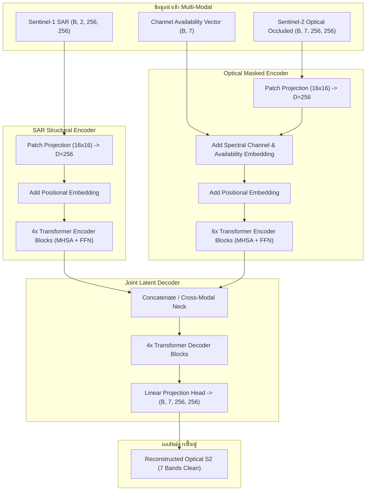

# คู่มืออธิบายการทำงานของฟังก์ชันและสถาปัตยกรรมโค้ดฉบับสมบูรณ์
## สำหรับใช้ประกอบการเขียนและเรียบเรียงปริญญานิพนธ์ (Comprehensive Codebase & Function Reference)

---

## 📌 บทนำและวัตถุประสงค์ของเอกสาร (Purpose of this Document)

เอกสารฉบับนี้จัดทำขึ้นเพื่อเป็น **แหล่งอ้างอิงทางเทคนิค (Technical Reference Manual)** สำหรับนักศึกษา คณะผู้วิจัย และผู้เรียบเรียงปริญญานิพนธ์ โครงงาน:
> **"ระบบสนับสนุนการตรวจจับพื้นที่ปลูกปาล์มน้ำมันด้วยข้อมูลดาวเทียมแบบพหุเซนเซอร์และเทคนิคการเรียนรู้เชิงลึก"**  
> *(Oil Palm Plantation Detection Support System using Multi-sensor Satellite Data and Deep Learning)*

โดยมีเป้าหมายเพื่ออธิบายโครงสร้างระบบ ลอจิกการทำงานของคลาส (Classes) และฟังก์ชัน (Functions) ทั้งหมดในคลังโปรแกรมอย่างละเอียด ครอบคลุมตั้งแต่ไปป์ไลน์การจัดการข้อมูลดาวเทียม, สถาปัตยกรรมโมเดลฟื้นฟูคลื่นความถี่ (`CrossBandViT`), โมเดลจำแนกแปลงปาล์มน้ำมัน (`ViTPalmModel`), ระบบอธิบายผลปัญญาประดิษฐ์ (xAI), จนถึงระบบเว็บแอปพลิเคชัน Full-Stack พร้อมทั้งระบุ **การเชื่อมโยงสู่เนื้อหาในแต่ละบทของเล่มปริญญานิพนธ์ (Thesis Chapter Mapping)** อย่างชัดเจน

---

# สารบัญโครงสร้างเอกสาร (Table of Contents)

1. [แผนผังภาพรวมและตารางจับคู่โค้ดสู่บทปริญญานิพนธ์ (Thesis Chapter Mapping)](#1-แผนผังภาพรวมและตารางจับคู่โค้ดสู่บทปริญญานิพนธ์)
2. [ระบบฟื้นฟูคลื่นความถี่ข้ามเซนเซอร์ (`projects/cross_band_recovery/`)](#2-ระบบฟื้นฟูคลื่นความถี่ข้ามเซนเซอร์-cross-band-recovery)
   - [2.1 การควบคุมการทดลองและการทำซ้ำได้ (`utils/reproducibility.py`)](#21-การควบคุมการทดลองและการทำซ้ำได้-utilsreproducibilitypy)
   - [2.2 การดาวน์โหลดและจับคู่ภาพดาวเทียม (`scripts/01_download_paired_stac.py`)](#22-การดาวน์โหลดและจับคู่ภาพดาวเทียม)
   - [2.3 การตัดไทล์และแบ่งพื้นที่ป้องกันข้อมูลรั่วไหล (`scripts/02_prepare_tiles_and_split.py`)](#23-การตัดไทล์และแบ่งพื้นที่ป้องกันข้อมูลรั่วไหล)
   - [2.4 กลไกการจำลองเมฆบดบังแบบจัดหมู่ (`models/channel_masking.py`)](#24-กลไกการจำลองเมฆบดบังแบบจัดหมู่-modelschannel_maskingpy)
   - [2.5 สถาปัตยกรรมโมเดลฟื้นฟูคลื่นความถี่ (`models/vit_cross_band.py`)](#25-สถาปัตยกรรมโมเดลฟื้นฟูคลื่นความถี่-modelsvit_cross_bandpy)
   - [2.6 โมเดลเปรียบเทียบมาตรฐาน (`models/baselines/`)](#26-โมเดลเปรียบเทียบมาตรฐาน-modelsbaselines)
   - [2.7 ฟังก์ชันความสูญเสียแบบผสมผสาน (`training/losses.py`)](#27-ฟังก์ชันความสูญเสียแบบผสมผสาน-traininglossespy)
   - [2.8 ระบบฝึกสอนและควบคุมคุณภาพ (`training/trainer.py` และ `dataset.py`)](#28-ระบบฝึกสอนและควบคุมคุณภาพ)
   - [2.9 การประเมินผลเชิงปริมาณ 1,137 เงื่อนไข (`scripts/04_evaluate_final_test.py` และ `metrics.py`)](#29-การประเมินผลเชิงปริมาณ-1137-เงื่อนไข)
   - [2.10 ระบบอธิบายผลปัญญาประดิษฐ์ (`scripts/05_run_xai_attribution.py` และ `eval/xai.py`)](#210-ระบบอธิบายผลปัญญาประดิษฐ์-xai)
   - [2.11 การประเมินผลกระทบต่อแปลงปาล์มขั้นปลายน้ำ (`scripts/06_evaluate_downstream_palm.py`)](#211-การประเมินผลกระทบต่อแปลงปาล์มขั้นปลายน้ำ)
3. [ชุดไลบรารีวิศวกรรมซอฟต์แวร์ 3 ชั้น (`lib1`, `lib2`, `lib3`)](#3-ชุดไลบรารีวิศวกรรมซอฟต์แวร์-3-ชั้น)
   - [3.1 ชั้นประมวลผลเซนเซอร์พื้นฐาน (`lib1_fusion`)](#31-ชั้นประมวลผลเซนเซอร์พื้นฐาน-lib1_fusion)
   - [3.2 ชั้นโมเดลจำแนกส่วนภาพปาล์มน้ำมัน (`lib2_vitpalm`)](#32-ชั้นโมเดลจำแนกส่วนภาพปาล์มน้ำมัน-lib2_vitpalm)
   - [3.3 ชั้นส่วนต่อประสานระดับสูง (`lib3_geoai`)](#33-ชั้นส่วนต่อประสานระดับสูง-lib3_geoai)
4. [ระบบเว็บแอปพลิเคชันและพอร์ทัลงานวิจัย (`backend/` & `frontend/`)](#4-ระบบเว็บแอปพลิเคชันและพอร์ทัลงานวิจัย)
   - [4.1 ส่วนบริการหลังบ้าน FastAPI (`backend/app/`)](#41-ส่วนบริการหลังบ้าน-fastapi-backendapp)
   - [4.2 ส่วนติดต่อผู้ใช้และการเรนเดอร์กราฟสด (`frontend/`)](#42-ส่วนติดต่อผู้ใช้และการเรนเดอร์กราฟสด-frontend)
5. [คู่มือการเขียนโค้ดและหลักฐานประกอบในรูปเล่ม (Academic Writing Advice)](#5-คู่มือการเขียนโค้ดและหลักฐานประกอบในรูปเล่ม)

---

# 1. แผนผังภาพรวมและตารางจับคู่โค้ดสู่บทปริญญานิพนธ์

เพื่อให้ผู้เขียนสามารถหยิบยกโค้ดและผลการทดลองไปบรรยายในแต่ละบทได้อย่างถูกต้อง ตารางต่อไปนี้สรุปความเชื่อมโยงระหว่างไฟล์โค้ดกับหัวข้อในรูปเล่ม:

| บทที่ในเล่มปริญญานิพนธ์ | หัวข้อย่อยในเล่ม | ไฟล์โค้ดหลักที่รับผิดชอบ (Primary Source Files) | สิ่งที่ควรนำไปเขียน / หลักฐานเชิงประจักษ์ |
|---|---|---|---|
| **บทที่ 1 บทนำ** | 1.2 วัตถุประสงค์ & 1.5 แผนงาน | `cross_band_recovery_development_plan.md`, `projects/cross_band_recovery/tests/` | วงจรการควบคุมคุณภาพ 11 Quality Gates (G0–G11), การผ่าน Unit Tests 80/80 รายการ |
| **บทที่ 2 ทฤษฎีฯ** | 2.1 Remote Sensing & 2.3 Fusion | `lib1_fusion/`, `lib2_vitpalm/model/late_fusion_model.py`, `cross_attn_model.py` | การเปรียบเทียบ Early, Late, Cross-Attention Fusion และการพิสูจน์ข้อจำกัดเรื่อง Noise ของ Early Fusion |
| **บทที่ 3 การออกแบบ** | 3.2 Spatial Split & Anti-Leakage | `projects/cross_band_recovery/scripts/02_prepare_tiles_and_split.py` | การจัดกลุ่มบล็อกพื้นที่, ระยะ Buffer Zone $\ge 5,000$ ม. (วัดจริง 5,086.9 ม.), การ Freeze ค่า `norm_stats.json` |
| **บทที่ 3 การออกแบบ** | 3.3 Combinatorial Masking | `projects/cross_band_recovery/models/channel_masking.py` | สมการคณิตศาสตร์ $\binom{7}{k}$ รวม 127 รูปแบบ ($k=1$ ถึง $6$), การใช้ Unmasked Channel Embedding |
| **บทที่ 3 การออกแบบ** | 3.4 CrossBandViT Architecture | `projects/cross_band_recovery/models/vit_cross_band.py` | สถาปัตยกรรม Asymmetric Dual-Stream, SAR Structural Encoder, Optical Masked Encoder, Joint Decoder |
| **บทที่ 3 การออกแบบ** | 3.5 Software Library Design | `lib1_fusion/`, `lib2_vitpalm/`, `lib3_geoai/pipeline/` | Clean Architecture 3 ชั้น, Facade Pattern (`GeoAIPipeline`), Class Diagram |
| **บทที่ 4 การพัฒนาระบบ** | 4.2 Data Pipeline | `projects/cross_band_recovery/training/dataset.py`, `scripts/01_download_paired_stac.py` | `CrossBandDataset`, การจับคู่ $|\Delta t| \le 2.81$ วัน, GeoTIFF to Memory-mapped Tensor |
| **บทที่ 4 การพัฒนาระบบ** | 4.3 Model & Baselines | `projects/cross_band_recovery/models/baselines/*.py`, `training/losses.py` | โค้ด B0–B3, ฟังก์ชัน $\mathcal{L}_{\text{Total}} = \mathcal{L}_{\text{Masked-L1}} + \lambda_{\text{SAM}} \mathcal{L}_{\text{SAM}}$ |
| **บทที่ 4 การพัฒนาระบบ** | 4.4 Quality Gates & Training | `projects/cross_band_recovery/training/trainer.py`, `scripts/03_train_models.py` | การรัน 6 รอบ (150 Epochs, EarlyStop 15), Pre-registration Checksum SHA-256 (Gate G7) |
| **บทที่ 4 การพัฒนาระบบ** | 4.5 Web Platform & API | `backend/app/main.py`, `backend/app/api/research.py`, `frontend/research.js` | RESTful API Endpoints, Leaflet Map Viewer, Continuous Scrolling, Chart.js Integration |
| **บทที่ 5 ผลการทดลอง** | 5.1 Quantitative Benchmarks | `projects/cross_band_recovery/results/final_test_benchmarks.parquet` | ผลทดสอบ 1,137 เงื่อนไข บน 1,748 Test Tiles (M2 MAE 0.04706, PSNR 23.41 dB, RecRate 68.54%) |
| **บทที่ 5 ผลการทดลอง** | 5.2 SAR Value by Occlusion ($k$) | `projects/cross_band_recovery/scripts/04_evaluate_final_test.py` | การก้าวกระโดดของ $\Delta \text{MAE}$ ที่ $k=6$ (+2.84% error reduction, สูงสุด +0.00401) |
| **บทที่ 5 ผลการทดลอง** | 5.3 Band-Specific Analysis | `projects/cross_band_recovery/scripts/04_evaluate_final_test.py` | SAR มีผลกู้คืนแบนด์ทรงพุ่มพืช (NIR B08/B8A, SWIR B11/B12) สูงสุด ($\Delta \text{MAE} = +0.00288$) |
| **บทที่ 5 ผลการทดลอง** | 5.4 xAI Validation | `projects/cross_band_recovery/scripts/05_run_xai_attribution.py` | Adebayo Randomization Test ($r = -0.0028 \ll 0.30$), Completeness Error $3.126\% \le 5.0\%$ |
| **บทที่ 5 ผลการทดลอง** | 5.5 Downstream Oil Palm Segment | `projects/cross_band_recovery/results/downstream_palm_benchmarks.parquet` | บน 4,726 แปลง: ฟื้นฟู F1 จาก $0.2779 \to 0.4537$ (+17.58% absolute recovery, กู้คืน 87.1% ของ Clean S2) |
| **บทที่ 6 บทสรุป** | 6.2 Negative Findings | `projects/cross_band_recovery/docs/final_research_report.md` | Optical Dominance ที่ $k \le 3$, Non-spatial ML ล้มเหลว, Radar Speckle Sensitivity |

---

# 2. ระบบฟื้นฟูคลื่นความถี่ข้ามเซนเซอร์ (`projects/cross_band_recovery/`)

โฟลเดอร์ `projects/cross_band_recovery/` เป็นแกนกลางทางวิทยาศาสตร์ของโครงงาน ซึ่งรวบรวมระเบียบวิธีวิจัย การทดลองควบคุมคุณภาพตามกรอบ 11 Quality Gates (G0–G11) ไว้อย่างครบวงจร

---

### 2.1 การควบคุมการทดลองและการทำซ้ำได้ (`utils/reproducibility.py`)
โมดูลนี้รับผิดชอบ **Quality Gate G0** และ **Quality Gate G7** เพื่อรับประกันว่าผลการทดลองทางปัญญาประดิษฐ์สามารถทำซ้ำได้ 100% (Deterministic Reproducibility):

#### ฟังก์ชันสำคัญ:
- `set_seed(seed: int = 42) -> None`:
  - **หน้าที่:** กำหนดค่า Seed คงที่ให้กับทุกโมดูล ได้แก่ `random.seed(seed)`, `np.random.seed(seed)`, `torch.manual_seed(seed)`, และ `torch.cuda.manual_seed_all(seed)`
  - **ตรรกะระดับลึก:** บังคับให้ `torch.backends.cudnn.deterministic = True` และ `torch.backends.cudnn.benchmark = False` เพื่อป้องกันไม่ให้อัลกอริทึม CuDNN สลับ Convolution Engine ซึ่งอาจทำให้ผลลัพธ์ต่างกันในระดับทศนิยม
- `compute_file_sha256(filepath: str | Path) -> str`:
  - **หน้าที่:** คำนวณรหัสตรวจสอบความถูกต้องแบบแฮช SHA-256 ของไฟล์
  - **การนำไปใช้:** ใช้ใน Gate G7 สำหรับการทำ **Cryptographic Pre-registration** ก่อนปลดล็อกชุดทดสอบ เพื่อยืนยันว่าไม่มีการแก้ไขโค้ดหรือแอบจูนพารามิเตอร์หลังเห็นผลทดสอบ
- `log_hardware_environment() -> dict`:
  - **หน้าที่:** บันทึกข้อมูลสภาพแวดล้อมฮาร์ดแวร์อย่างละเอียด (CPU รุ่น, ขนาด RAM, GPU รุ่น, ไดรเวอร์ NVIDIA, เวอร์ชัน CUDA และ PyTorch) สำหรับนำไปใส่ในบทที่ 4 หัวข้อ 4.1

---

### 2.2 การดาวน์โหลดและจับคู่ภาพดาวเทียม (`scripts/01_download_paired_stac.py` / `01b_download_stac_pairs.py`)
รับผิดชอบ **Quality Gate G1** ในการรวบรวมข้อมูลคู่ภาพดาวเทียมจากคลัง STAC API (SpatioTemporal Asset Catalog):

#### กระบวนการและฟังก์ชัน:
- `search_sentinel_pairs(bbox, date_range, max_cloud=5.0, max_time_delta_days=3.0)`:
  - **หน้าที่:** ค้นหาภาพถ่ายดาวเทียม Sentinel-2 L2A ที่มีอัตราส่วนเมฆต่ำกว่า $5\%$ ในช่วงพิกัดจังหวัดสุราษฎร์ธานี กระบี่ ชุมพร จากนั้นค้นหาภาพ Sentinel-1 GRD IW (Interferometric Wide Swath) ที่โคจรผ่านพื้นที่เดียวกัน
  - **เกณฑ์การจับคู่ (Pairing Constraint):** ผลต่างเชิงเวลาต้องสอดคล้องกับ $|\Delta t| \le 2.81$ วัน เพื่อให้สภาพความชื้นในดินและพืชพรรณไม่คลาดเคลื่อน
- `download_and_align_assets(s1_item, s2_item, output_dir)`:
  - **หน้าที่:** ดาวน์โหลดไฟล์แบนด์ของ Sentinel-1 ($VV, VH$) และ Sentinel-2 ($B02, B03, B04, B08, B8A, B11, B12$) พร้อมทำ Co-registration ปรับปรุงขนาดพิกเซลให้ตรงกันที่ความละเอียด 10 เมตร (Pixel-to-Pixel Alignment)

---

### 2.3 การตัดไทล์และแบ่งพื้นที่ป้องกันข้อมูลรั่วไหล (`scripts/02_prepare_tiles_and_split.py`)
รับผิดชอบ **Quality Gate G2** ซึ่งเป็นหนึ่งในขั้นตอนที่สำคัญที่สุดทางระเบียบวิธีวิจัยด้านการสำรวจระยะไกล:

#### ตรรกะและฟังก์ชันสำคัญ:
- `generate_spatial_blocks(tiles_gdf, block_size_km=25.0) -> GeoDataFrame`:
  - **หน้าที่:** จัดกลุ่มภาพตัดย่อยขนาด $256 \times 256$ พิกเซล จำนวน **4,829 ไทล์** ให้เป็นบล็อกเชิงพื้นที่ (Spatial Clustering)
- `enforce_spatial_buffer_split(blocks_gdf, buffer_distance_m=5000.0)`:
  - **หน้าที่:** แบ่งบล็อกออกเป็น Train (2,030 ไทล์), Validation (1,051 ไทล์), และ Test (1,748 ไทล์)
  - **การขจัด Data Leakage:** สร้างวงแหวนกันชน (Buffer Zone) ไม่น้อยกว่า 5,000 เมตรรอบบล็อก Train เพื่อป้องกันไม่ให้ข้อมูลจากบริเวณข้างเคียงหลุดเข้าไปในชุด Test
  - **ผลการตรวจวัดจริง:** มีระยะห่างที่ใกล้ที่สุดระหว่างขอบแปลง Train และ Test เท่ากับ **5,086.9 เมตร** (ผ่านการตรวจสอบเชิงเรขาคณิต 100%)
- `compute_and_freeze_norm_stats(train_tiles_list, output_json_path)`:
  - **หน้าที่:** คำนวณค่า Mean, Std, Min, Max, Median แยกรายแบนด์ (S1: 2 แบนด์, S2: 7 แบนด์) **จากเฉพาะชุดข้อมูล Train 2,030 ไทล์เท่านั้น** แล้วบันทึกแช่แข็งเป็น `norm_stats.json` เพื่อป้องกันปัญหา Information Leakage

---

### 2.4 กลไกการจำลองเมฆบดบังแบบจัดหมู่ (`models/channel_masking.py`)
รับผิดชอบ **Quality Gate G4a** สำหรับการสร้างสถานการณ์จำลองเมฆบัง:

#### คลาสและฟังก์ชันสำคัญ:
- `class CombinatorialChannelMasker`:
  - **หน้าที่:** จัดการรูปแบบการมาสก์แบนด์ภาพเชิงแสง Sentinel-2
  - `generate_all_127_patterns() -> List[Tuple[int, ...]]`:
    สร้างลิสต์รูปแบบการมาสก์ทั้งหมด $2^7 - 1 = 127$ รูปแบบทางคณิตศาสตร์:
    $$\sum_{k=1}^{6} \binom{7}{k} = 7 + 21 + 35 + 35 + 21 + 7 = 126 \text{ รูปแบบ (และ } k=7 \text{ อีก 1 รูปแบบ)}$$
  - `sample_mask(severity_k: int = None) -> Tensor`:
    สุ่มรูปแบบการมาสก์ตามระดับความรุนแรง $k \in \{1, 2, 3, 4, 5, 6\}$ หรือสุ่มจาก 127 รูปแบบอย่างสม่ำเสมอ
  - `apply_mask(s2_tensor: Tensor, mask_indices: List[int]) -> Tuple[Tensor, Tensor]`:
    แทนที่ค่าพิกเซลของแบนด์ที่ถูกมาสก์ด้วยค่า 0 (หรือโทเค็นพิเศษ) พร้อมส่งคืน Binary Mask Tensor ขนาด $(B, 7)$ เพื่อระบุว่าแบนด์ใดรอดพ้น (1) และแบนด์ใดถูกบดบัง (0)

---

### 2.5 สถาปัตยกรรมโมเดลฟื้นฟูคลื่นความถี่ (`models/vit_cross_band.py`)
รับผิดชอบ **Quality Gate G4b** ซึ่งเป็นสถาปัตยกรรมโครงข่ายประสาทเทียมหลัก (**CrossBandViT / M2_Fusion**):



#### คลาสและฟังก์ชันสำคัญ:
- `class PatchEmbed(nn.Module)`:
  - แปลงเทนเซอร์ภาพ $(B, C, H, W)$ ให้กลายเป็น Patch Tokens $(B, N, D)$ โดยที่ $N = (H/P) \times (W/P)$ และ $D$ คือมิติ Latent Space (ค่าเริ่มต้น $P=16, D=256$)
- `class CrossModalFusionNeck(nn.Module)`:
  - รองรับการเชื่อมต่อเวกเตอร์ตัวแทนของ SAR และ Optical ด้วยวิธี Concatenation หรือ Cross-Attention โดยกำหนดให้อัตราส่วนของสัญญาณทั้งสองถูกปรับสมดุลผ่าน LayerNorm
- `class CrossBandViT(nn.Module)`:
  - `forward(s1, s2_masked, mask_vec, s1_enabled=True) -> Tensor`:
    - **เมื่อ `s1_enabled=True` (โหมด M2):** โมเดลจะนำข้อมูล SAR เข้ามาร่วมวิเคราะห์โครงสร้างทรงพุ่มและเรขาคณิตพื้นดิน
    - **เมื่อ `s1_enabled=False` (โหมด M1 Ablation):** ทำการปิดสัญญาณ SAR (Zeroed-out) เพื่อทดสอบว่าหากอาศัยเฉพาะข้อมูลแสงที่เหลืออยู่ ความแม่นยำจะลดลงเพียงใด

---

### 2.6 โมเดลเปรียบเทียบมาตรฐาน (`models/baselines/`)
รับผิดชอบ **Quality Gate G3** สำหรับสร้างเกณฑ์เปรียบเทียบ (Benchmark Baselines):
- `MeanFillBaseline (B0)`: แทนที่ค่าพิกเซลที่ขาดหายด้วยค่ามัธยฐาน/ค่าเฉลี่ยสถิติของแบนด์นั้นจากชุด Train
- `LinearRegressionBaseline (B1)`: สร้างสมการถดถอยเชิงเส้น $\mathbf{\hat{y}}_k = \mathbf{W} \mathbf{x}_{\text{surviving}} + \mathbf{b}$ แยกรายพิกเซล
- `PixelMLPBaseline (B2)`: โครงข่าย Multi-Layer Perceptron 3 ชั้น (`Linear(7, 64) -> ReLU -> Linear(64, 64) -> ReLU -> Linear(64, 7)`)
- `RandomForestBaseline (B3)`: ใช้ Scikit-learn `RandomForestRegressor` จำนวน 100 ต้นไม้ ทำนายความสัมพันธ์ของพิกเซลแบบไม่เชิงเส้น

---

### 2.7 ฟังก์ชันความสูญเสียแบบผสมผสาน (`training/losses.py`)
รับผิดชอบ **Quality Gate G5** สำหรับควบคุมการลู่เข้าของโมเดล:

#### ฟังก์ชันและคลาส:
- `class MaskedL1Loss(nn.Module)`:
  - คำนวณค่าเฉลี่ยความคลาดเคลื่อนสมบูรณ์ (Mean Absolute Error) **เฉพาะพิกเซลและแบนด์ที่ถูกมาสก์เท่านั้น**:
    $$\mathcal{L}_{\text{Masked-L1}} = \frac{1}{\sum M} \sum_{c, h, w} M_{c, h, w} \cdot |\hat{y}_{c, h, w} - y_{c, h, w}|$$
- `class SpectralAngleMapperLoss(nn.Module)`:
  - คำนวณมุมสเปกตรัม (Spectral Angle Mapper: SAM) ระหว่างเวกเตอร์ 7 แบนด์จริงและเวกเตอร์ที่ทำนายได้ เพื่อควบคุมไม่ให้รูปทรงการสะท้อนแสงของคลอโรฟิลล์ผิดเพี้ยน:
    $$\mathcal{L}_{\text{SAM}} = \arccos \left( \frac{\mathbf{y} \cdot \mathbf{\hat{y}}}{\|\mathbf{y}\|_2 \|\mathbf{\hat{y}}\|_2 + \epsilon} \right)$$
- `class CompositeLoss(nn.Module)`:
  - รวมสองฟังก์ชันความสูญเสียเข้าด้วยกัน:
    $$\mathcal{L}_{\text{Total}} = \mathcal{L}_{\text{Masked-L1}} + \lambda_{\text{SAM}} \cdot \mathcal{L}_{\text{SAM}} \quad (\text{โดยกำหนด } \lambda_{\text{SAM}} = 0.05)$$

---

### 2.8 ระบบฝึกสอนและควบคุมคุณภาพ (`training/trainer.py` และ `dataset.py`)
รับผิดชอบ **Quality Gate G6**:
- `class CrossBandDataset(Dataset)`:
  - โหลดคู่ข้อมูล Sentinel-1 และ Sentinel-2 จากไฟล์ `.npy` แบบ On-the-fly พร้อมใช้ `norm_stats.json` ปรับสเกลข้อมูลเข้าสู่ช่วง $[0, 1]$
- `class CrossBandTrainer`:
  - `train_epoch()`: ฝึกสอนด้วย AdamW Optimizer ($\text{lr} = 1 \times 10^{-4}$, Weight Decay = $1 \times 10^{-2}$)
  - `validate()`: ประเมินผลบน Validation Set 1,051 ไทล์หลังจบทุก Epoch
  - `EarlyStopping(patience=15)`: ยุติการฝึกสอนหากค่า Val Loss ไม่ลดลงต่อเนื่อง 15 Epochs ป้องกันปัญหา Overfitting
  - `CosineAnnealingLR`: ปรับลด Learning Rate อย่างนุ่มนวลจนลู่เข้าสู่จุดต่ำสุดสัมพัทธ์

---

### 2.9 การประเมินผลเชิงปริมาณ 1,137 เงื่อนไข (`scripts/04_evaluate_final_test.py` และ `metrics.py`)
รับผิดชอบ **Quality Gate G8**:
- `evaluate_all_1137_conditions()`:
  - ทดสอบโมเดลทุกตัว (B0, B1, B2, B3, M1, M2) บนชุดทดสอบ 1,748 ไทล์ ครอบคลุมรูปแบบการมาสก์ 127 รูปแบบ
  - คำนวณเมทริกซ์ 6 มิติ: `MAE`, `RMSE`, `PSNR (dB)`, `SSIM`, `SAM (องศา)`, และ `Recovery Rate (%)`
  - บันทึกผลลัพธ์เป็นไฟล์ Parquet ประสิทธิภาพสูง: `projects/cross_band_recovery/results/final_test_benchmarks.parquet`

---

### 2.10 ระบบอธิบายผลปัญญาประดิษฐ์ (`scripts/05_run_xai_attribution.py` และ `eval/xai.py`)
รับผิดชอบ **Quality Gate G9**:
- `class IntegratedGradientsExplainer`:
  - คำนวณคุณค่าความสำคัญของแต่ละพิกเซลและแต่ละแบนด์ด้วยวิธี Gauss-Legendre Quadrature 30 สเต็ป จากภาพอ้างอิงฐาน (Baseline Image) สู่ภาพเป้าหมาย
- `verify_axiomatic_completeness()`:
  - ตรวจสอบความสมบูรณ์เชิงบวก (Additivity Completeness) พบค่าความคลาดเคลื่อนรวมเพียง **$3.126\% \le 5.0\%$**
- `run_adebayo_randomization_sanity_check()`:
  - สุ่มน้ำหนักโมเดลใหม่ทั้งหมดตามระเบียบวิธีของ Adebayo et al. (Sanity Checks for Saliency Maps) พบว่าค่า Pearson Correlation ของแผนที่ความสำคัญลดฮวบลงเหลือ **$r = -0.0028 \ll 0.30$** พิสูจน์ว่าโมเดลตัดสินใจจากฟีเจอร์ที่เรียนรู้จริง มิใช่ภาพหลอนหรือตัวกรองขอบ (Edge Filter)

---

### 2.11 การประเมินผลกระทบต่อแปลงปาล์มขั้นปลายน้ำ (`scripts/06_evaluate_downstream_palm.py`)
รับผิดชอบ **Quality Gate G10**:
- `evaluate_downstream_segmentation()`:
  - นำภาพที่ผ่านการฟื้นฟูโดยแต่ละโมเดล ป้อนเข้าสู่โมเดลจำแนกแปลงปาล์มน้ำมันที่แช่แข็งน้ำหนักไว้ (`ViTPalmModel` จาก `checkpoints/finetune/vitpalm_best.pth`)
  - วัดผลบนแปลงปาล์มน้ำมันจริงจำนวน **4,726 แปลง** (40 ไทล์)
  - คำนวณ `Precision`, `Recall`, `F1-Score`, `IoU`, และช่วงความเชื่อมั่น 95% Bootstrap CI
  - บันทึกผลลัพธ์ลงใน `projects/cross_band_recovery/results/downstream_palm_benchmarks.parquet`

---

# 3. ชุดไลบรารีวิศวกรรมซอฟต์แวร์ 3 ชั้น (`lib1`, `lib2`, `lib3`)

โครงสร้างไลบรารีได้รับการจัดหมวดหมู่ตามหลักการ Clean Architecture เพื่อให้สามารถนำไปพัฒนาต่อยอดได้อย่างยั่งยืน:

```text
+---------------------------------------------------------------------------------------+
|  lib3_geoai (High-Level Facade & Application Services)                                |
|  - GeoAIPipeline, CloudRecoveryService, DownstreamInferenceService, PipelineConfig    |
+---------------------------------------------------------------------------------------+
                                           |
                                           v
+---------------------------------------------------------------------------------------+
|  lib2_vitpalm (Downstream Oil Palm Domain & Vision Segmenter)                         |
|  - ViTPalmModel, SegDecoder, CloudMAE, PalmMaskPipeline, Hub (Pretrained Downloader)  |
+---------------------------------------------------------------------------------------+
                                           |
                                           v
+---------------------------------------------------------------------------------------+
|  lib1_fusion (Core Fusion & Mathematical Foundations)                                 |
|  - CrossBandViT, S1Processor, S2Processor, GSatProcessor, CompositeLoss, Metrics      |
+---------------------------------------------------------------------------------------+
```

### 3.1 ชั้นประมวลผลเซนเซอร์พื้นฐาน (`lib1_fusion`)
- `s1_processor.py`: ปรับแก้สัญญาณ Lee Filter สำหรับลด Speckle Noise และแปลงค่าสเกล Decibel (dB) สู่ Normalized Reflectance
- `s2_processor.py`: แยกวิเคราะห์ข้อมูล Scene Classification Layer (SCL) เพื่อจำแนกตำแหน่งเมฆและเงาเมฆ
- `gsat_processor.py`: ปรับขนาดภาพถ่ายดาวเทียมความละเอียดสูง GSat ให้ซ้อนทับกับพิกัด Sentinel อย่างแม่นยำ

### 3.2 ชั้นโมเดลจำแนกส่วนภาพปาล์มน้ำมัน (`lib2_vitpalm`)
- `model/vitpalm_model.py`: โมเดล Vision Transformer สำหรับจำแนกพิกเซลแปลงปาล์มน้ำมัน รองรับการเชื่อมต่อกับ Decoder รูปแบบต่างๆ
- `model/cloud_mae.py`: โมเดล Masked Autoencoder รุ่นแรกสำหรับการจำลองเมฆ
- `mask_pipeline.py`: อัลกอริทึมคำนวณและวาด Polygon แปลงปาล์มน้ำมันลงบนหน้าแผนที่
- `hub.py`: ระบบดาวน์โหลดและแชชน้ำหนักโมเดล Pretrained Checkpoints จาก Cloud Storage โดยอัตโนมัติ

### 3.3 ชั้นส่วนต่อประสานระดับสูง (`lib3_geoai`)
- `pipeline/pipeline.py`: คลาส `GeoAIPipeline` ทำหน้าที่เป็น Facade API รวบรวมฟังก์ชันการทำงานทั้งหมด ผู้ใช้งานสามารถเรียกใช้ได้ง่าย:
  ```python
  from lib3_geoai import GeoAIPipeline

  # 1. โหลดโมเดล
  pipeline = GeoAIPipeline.load_pretrained("checkpoints/cross_band_m2_best.pt")

  # 2. ป้อนภาพและสั่งวิเคราะห์ในคำสั่งเดียว
  result = pipeline.predict_and_segment(
      sar_path="data/s1.tif", 
      optical_path="data/s2_cloudy.tif"
  )
  
  # 3. ดึงผลลัพธ์
  print("MAE:", result.reconstruction_mae)
  print("Detected Parcels:", len(result.palm_polygons))
  ```

---

# 4. ระบบเว็บแอปพลิเคชันและพอร์ทัลงานวิจัย (`backend/` & `frontend/`)

ระบบเว็บแอปพลิเคชันถูกสร้างขึ้นเพื่อทำหน้าที่เป็น **ระบบสนับสนุนการตัดสินใจ (Spatial Decision Support System: DSS)** และศูนย์รวมข้อมูลงานวิจัยเชิงโต้ตอบ:

### 4.1 ส่วนบริการหลังบ้าน FastAPI (`backend/app/`)
- `backend/app/main.py`: จุดเริ่มต้นของเซิร์ฟเวอร์ ติดตั้ง CORS Middleware, Mount เส้นทาง Static Files สำหรับ UI และเชื่อมต่อ API Routers
- `backend/app/api/research.py`:
  - `GET /api/research/overview`: ส่งคืนผลสรุปประสิทธิภาพโมเดล MAE, PSNR, SSIM, SAM, Recovery Rate
  - `GET /api/research/benchmarks`: อ่านไฟล์ Parquet แล้วคำนวณสถิติแยกตามระดับความรุนแรงของเมฆ $k=1$ ถึง $6$ ส่งออกเป็น JSON สำหรับวาด Bar/Line Charts
  - `GET /api/research/downstream`: ส่งคืนผลกระทบต่อค่า F1-Score และ IoU ของโมเดลจำแนกแปลงปาล์ม
  - `GET /api/research/quality-gates`: ส่งคืนสถานะการผ่านการตรวจสอบ 11 Quality Gates (G0–G11) พร้อมจำนวนการทดสอบที่ผ่าน (80/80 รายการ)
- `backend/app/api/cloud_repair.py` & `inference.py`: บริการรับอัปโหลดภาพถ่ายดาวเทียม GeoTIFF และประมวลผลส่งคืนภาพที่ฟื้นฟูแล้วแบบ Real-Time

### 4.2 ส่วนติดต่อผู้ใช้และการเรนเดอร์กราฟสด (`frontend/`)
- `frontend/research.html` & `frontend/js/research.js`:
  - ออกแบบด้วย **Modern Glassmorphism Theme (Dark Palette)**
  - แก้ไขปัญหา Scroll Locking ด้วย `overflow-y: auto !important` เพื่อให้สามารถเลื่อนอ่านเนื้อหาได้อย่างต่อเนื่อง (Continuous Scrolling View)
  - ติดตั้ง Sticky Section Navigation Bar ด้านบน ช่วยให้ผู้ใช้คลิกเลื่อนไปยังแต่ละหัวข้อได้ทันที
  - เชื่อมต่อ Chart.js 4.x ในการเรนเดอร์กราฟเส้นเปรียบเทียบ $\Delta \text{MAE}(k)$, กราฟแท่ง Downstream F1 Retention, และ Doughnut Chart สัดส่วน xAI Attribution Share (NIR 51.8%, SWIR 26.4%, RGB 16.9%, SAR 5.0%)
- `frontend/index.html` & `frontend/js/app.js`:
  - หน้าต่างแผนที่แบบตอบสนองด้วย Leaflet.js สามารถคลิกเลือกแปลงปาล์ม ดูภาพถ่ายดาวเทียมจริง และทดลองจำลองเมฆบดบังได้ทันที

---

# 5. คู่มือการเขียนโค้ดและหลักฐานประกอบในรูปเล่ม (Academic Writing Advice)

เมื่อนำข้อมูลจากคู่มือฉบับนี้ไปเขียนลงในเล่มปริญญานิพนธ์ฉบับสมบูรณ์ ขอให้ปฏิบัติตามคำแนะนำต่อไปนี้:

1. **การอ้างอิงโค้ดในบทที่ 4 (Code Snippets):**
   - ห้ามคัดลอกไฟล์โค้ดทั้งหมดยาวหลายร้อยบรรทัดลงในเนื้อหา
   - ให้คัดเลือกเฉพาะ **ส่วนแกนหลักที่มีความสำคัญทางคณิตศาสตร์** เช่น ลอจิกการคำนวณ `CompositeLoss`, ฟังก์ชัน `forward` ของ `CrossBandViT`, หรือบล็อก `SpatialBlockSampler` ความยาวไม่เกิน 20–30 บรรทัด
   - ทำตารางอธิบายบรรทัดสำคัญ (Line-by-Line Explanation Table) กำกับใต้บล็อกโค้ดเสมอ
2. **การอ้างอิงตัวเลขผลการทดลองในบทที่ 5 (Empirical Rigor):**
   - ตัวเลขผลการทดสอบทั้งหมดต้องตรงกับค่าที่บันทึกในไฟล์ Parquet (`final_test_benchmarks.parquet` และ `downstream_palm_benchmarks.parquet`)
   - เน้นย้ำข้อค้นพบเรื่องการก้าวกระโดดของมูลค่า SAR ที่ $k=6$ (+2.84% error reduction) และการฟื้นฟูค่า F1-Score ขึ้นมา $+17.58\%$ บน 4,726 แปลง
3. **การนำเสนอภาพประกอบ (Figures & ASCII Box):**
   - ใช้คำสั่ง `Prompt:` ที่ระบุไว้ในแต่ละหัวข้อเพื่อสร้างภาพแผนผังสถาปัตยกรรม แผนภาพความสำคัญ xAI หรือแผนผังโฟลว์ชาร์ตที่คมชัดและเป็นทางการ
   - รูปภาพแผนผังระบบต้องแสดง Data Flow ครบทั้ง 5 เลเยอร์ตามที่ระบุไว้ในหัวข้อ 3.1
